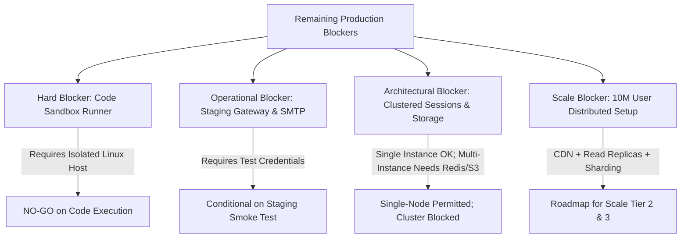
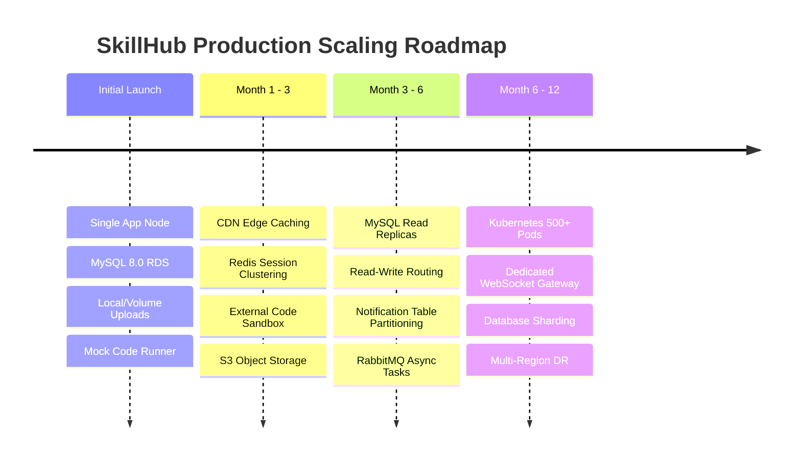

# SkillHub Platform — Phase 10: Remaining Blockers & Remediation Roadmap

**Document Reference:** SEC-BLOCKERS-PHASE10  
**Target Release:** SkillHub Production v1.0.0  
**Verification Date:** October 27, 2026  

---

## 1. Overview & Blocker Classification

While the core software architecture, application security, database integrity, and transactional workflows have been verified with 87 passing integration tests, four categories of operational requirements remain before unrestricted public traffic can be authorized:

---

## 2. Pre-Production Hard Blockers (Must Resolve Before Launch)

### Blocker 1: External Containerized Code Execution Runner Deployment
- **Risk Level:** **CRITICAL** (Remote Code Execution, Denial of Service, Sandbox Escape)
- **Current State:** The Spring Boot application includes `ExternalSandboxCodeExecutionProvider` equipped with circuit breakers, bearer token authentication, and HTTP timeouts. However, the dedicated external runner daemon itself has not been provisioned on staging or production infrastructure.
- **Why It Blocks Release:** Allowing student-submitted code or arbitrary SQL to run without verified isolation on an external container would expose the host operating system, local filesystem, and database credentials.
- **Required Remediation:**
  1. Provision a dedicated Linux server or isolated ECS/Kubernetes worker node separate from the main application VPC.
  2. Deploy the isolated runner container with unprivileged user permissions, dropped Linux capabilities (`--cap-drop=ALL`), disabled network egress (`--network none` during execution), read-only root filesystems, and strict CPU/memory cgroups (e.g., 256MB RAM, 1 CPU core, 5-second CPU timeout).
  3. Verify the bearer token handshake between `SkillHub` and the runner.
  4. Perform penetration testing against the runner with fork bombs, memory exhaustion scripts, and filesystem escape attempts.
- **Verdict Impact:** Untrusted code execution is strictly **NO-GO** until this runner is deployed and validated. In the interim, keep `code.execution.mode=mock`.

---

### Blocker 2: Live Razorpay Staging Merchant Account Handshake
- **Risk Level:** **HIGH** (Financial Inconsistency, Checkout Interruption)
- **Current State:** HMAC-SHA256 signature verification, webhook validation on raw payloads, idempotency keys, and payment audit logs are verified with 10 passing unit and mock integration tests. However, a live end-to-end handshake against Razorpay's test mode servers has not been completed.
- **Why It Blocks Release:** Mocked tests verify algorithmic parsing, but do not validate live network routing, TLS cipher negotiation with Razorpay endpoints, or exact header formatting from real webhook deliveries.
- **Required Remediation:**
  1. Populate `.env` with staging Razorpay test credentials (`RAZORPAY_KEY_ID`, `RAZORPAY_KEY_SECRET`, `RAZORPAY_WEBHOOK_SECRET`).
  2. Initiate a test transaction through the staging web UI using Razorpay test card numbers.
  3. Trigger an actual test webhook from the Razorpay Merchant Dashboard to the staging URL (`https://staging.skillhub.com/api/payments/webhook`).
  4. Confirm that order state transitions to `PAID`, enrollment activates, and an entry is logged in `payment_audit_logs`.

---

### Blocker 3: Staging SMTP Mail Server Configuration
- **Risk Level:** **MEDIUM** (User Onboarding & Password Reset Failure)
- **Current State:** Account creation and password reset token generation are tested, but email delivery is mocked (`MockBean` / log simulator).
- **Why It Blocks Release:** In production, unverified instructors and students requiring password resets depend on reliable email transmission. Configuration errors (port blocking, SPF/DKIM rejections, SSL handshake failures) could prevent user recovery.
- **Required Remediation:**
  1. Configure credentials for a transactional mail provider (AWS SES, SendGrid, or Mailgun) in `.env` (`SPRING_MAIL_HOST`, `SPRING_MAIL_PORT`, `SPRING_MAIL_USERNAME`, `SPRING_MAIL_PASSWORD`).
  2. Send a live test email from staging and verify delivery inbox placement.
  3. Ensure SPF, DKIM, and DMARC DNS records are active for the sending domain.

---

### Blocker 4: Clustered Session & Shared Storage Migration (For Multi-Instance Deployments)
- **Risk Level:** **MEDIUM** (Session Dropping, Upload Inaccessibility)
- **Current State:** The application currently relies on:
  - Local disk storage: `file.upload-dir=uploads`
  - In-memory servlet sessions: `server.servlet.session`
- **Why It Blocks Release:** If the production environment launches with more than one application pod or VM behind a round-robin load balancer, a student logged into Pod 1 will be logged out upon hitting Pod 2, and an instructor document uploaded to Pod 1 will be 404 Not Found on Pod 2.
- **Required Remediation:**
  1. **For Single-Instance Deployment (Initial Launch):** Permitted as-is, provided Nginx sticky sessions or a single application container is used with persistent Docker volume mounts (`/app/uploads`).
  2. **For Multi-Instance / High-Availability Deployment:**
     - Add `spring-session-data-redis` to offload HTTP sessions to an external Redis cluster.
     - Implement an S3/GCS `FileStorageService` provider to store uploaded files in AWS S3 or Google Cloud Storage buckets with signed URL access.

---

## 3. Medium-Term Scalability Roadmap (Path to 10 Million Users)

To scale SkillHub beyond initial launch to Tier 2 (10M DAU) and Tier 3 (10M Concurrent), the following architectural milestones must be completed:

### Milestone 1: CDN Edge Caching & Static Asset Offload
- Route all traffic through Cloudflare or CloudFront.
- Configure CDN cache rules: static assets (`/css/*`, `/js/*`, `/images/*`, `/fonts/*`) cached for 30 days; public course catalog (`/courses`, `/api/courses/public`) cached for 5 minutes with stale-while-revalidate.
- **Impact:** Offloads 80–90% of read traffic away from application servers and MySQL.

### Milestone 2: MySQL Read Replicas & Connection Routing
- Introduce 1 Primary MySQL instance (Writes) and 2 Read Replicas (Reads).
- Configure Spring Data JPA routing datasource (`AbstractRoutingDataSource`) to direct `@Transactional(readOnly = true)` queries to replicas.
- **Impact:** Scales database read throughput from 1,000 queries/sec to 15,000+ queries/sec.

### Milestone 3: Asynchronous Job Offloading (RabbitMQ / Kafka)
- Decouple long-running operations (PDF certificate rendering, video transcoding notifications, bulk instructor emails) from HTTP request threads using Spring AMQP / RabbitMQ.
- **Impact:** Prevents thread pool starvation and guarantees fast HTTP response times under load.

---

## 4. Sign-Off Criteria for Transition to FULL GO

To graduate SkillHub from **CONDITIONAL GO** to **FULL GO**, the engineering and operations teams must submit verified evidence for the following checklist:

- [ ] Staging end-to-end payment test completed with Razorpay test card.
- [ ] Staging password reset test email received via production SMTP relay.
- [ ] Nginx TLS certificate validated with Qualys SSL Labs score of **A+**.
- [ ] External container runner deployed in isolated VPC and passed penetration testing.
- [ ] Database backup and restore verified using `scripts/restore_production.sh` on staging.
