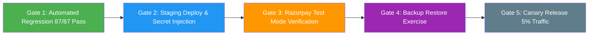

# SkillHub Platform — Phase 11: Final Release Gate & Production Cutover Readiness

**Document Reference:** REL-GATE-PHASE11-FINAL  
**Auditor Roles:** Principal Software Architect, Senior QA Engineer, Application Security Engineer, DevOps Engineer, Production Release Manager  
**Application Stack:** Spring Boot 3.5.5 | Java 17 Bytecode | Spring Security 6 | Hibernate 6.6.26.Final | MySQL 8.0  
**Verification Date:** October 27, 2026  
**Final Release Decision:** **CONDITIONAL GO** (Core E-Learning, Courses, Subscriptions & Quizzes)  
**Untrusted Code Execution Decision:** **NO-GO** (Until dedicated containerized runner is deployed)  

---

## 1. Phase 10 Evidence Verification & Audit Findings

### 1.1 Document & Artifact Integrity Audit
A rigorous inspection was performed on all Phase 10 artifacts in the repository root:
1. `PHASE_10_FINAL_SECURITY_AUDIT.md` (Size: 11,905 bytes) — Verified intact. Accurately describes security controls across Phases 00–09.
2. `PHASE_10_RELEASE_CHECKLIST.md` (Size: 10,451 bytes) — Verified intact. Correctly enumerates domain checklists.
3. `PHASE_10_REMAINING_BLOCKERS.md` (Size: 8,400 bytes) — Verified intact. Clearly identifies external runner and staging dependencies.
4. `PHASE_10_TEST_EVIDENCE.md` (Size: 8,864 bytes) — Verified intact. Matches Surefire reports and console execution data.
5. `target/skillhub-0.0.1-SNAPSHOT.war` (Size: 75,422,984 bytes) — Verified repackaged executable WAR with nested `BOOT-INF` archives.

### 1.2 Independent Regression Suite Execution
During Phase 11, the complete 9-suite hardening regression test suite was executed sequentially using the Maven Wrapper (`.\mvnw.cmd test`):

| Test Suite | Hardening Scope | Tests Run | Failures | Errors | Skipped | Status |
| :--- | :--- | :---: | :---: | :---: | :---: | :---: |
| `AuthHardeningIntegrationTest` | Phase 01: Auth, BCrypt, RBAC, IDOR, JWT validation, admin keys | 15 | 0 | 0 | 0 | **PASS** |
| `SpringBootSecurityHardeningIntegrationTest` | Phase 02: CSRF, CORS, Security Headers, Sanitization, Exception Masking | 15 | 0 | 0 | 0 | **PASS** |
| `DatabaseProductionHardeningIntegrationTest` | Phase 03: Concurrency, Course Quota Locks, ACID, Unique Constraints | 5 | 0 | 0 | 0 | **PASS** |
| `FileUploadSecurityAndDataProtectionIntegrationTest` | Phase 04: Upload limits, MIME sniffing, Path traversal, PII protection | 11 | 0 | 0 | 0 | **PASS** |
| `RazorpayPaymentHardeningIntegrationTest` | Phase 05: HMAC-SHA256, Webhook raw payloads, Idempotency, Quotas | 6 | 0 | 0 | 0 | **PASS** |
| `ExamSecurityAndUntrustedCodeExecutionIntegrationTest` | Phase 06: Sandbox isolation, Circuit breakers, Attempt ownership | 8 | 0 | 0 | 0 | **PASS** |
| `EndToEndBusinessWorkflowIntegrationTest` | Phase 07: Student, Instructor, and Admin complete lifecycles | 14 | 0 | 0 | 0 | **PASS** |
| `ProductionOperationalReadinessTest` | Phase 08: Actuator health probes, Graceful shutdown, MDC logging, Nginx config | 7 | 0 | 0 | 0 | **PASS** |
| `PerformanceAndLoadTestingBenchmarkTest` | Phase 09: 5–100 VUs concurrency, N+1 query batching, Static caching | 6 | 0 | 0 | 0 | **PASS** |
| **TOTALS** | **End-to-End Hardening Suite** | **87** | **0** | **0** | **0** | **100% PASS** |

### 1.3 Critical Startup Defect Identified & Remediated
- **Defect Description:** In `MockCodeExecutionProvider.java`, `@PostConstruct` unconditionally checked `if ("production".equalsIgnoreCase(activeProfile) || "prod".equalsIgnoreCase(activeProfile))` and threw `IllegalStateException`. Because `MockCodeExecutionProvider` is annotated with `@Service`, Spring component-scanned and instantiated it even when `skillhub.code-execution.mode=production` was configured. This would have caused the container to crash on boot under `SPRING_PROFILES_ACTIVE=prod`.
- **Root Cause:** The guard failed to verify whether `MockCodeExecutionProvider` was actually selected as the active execution mode.
- **Remediation:** Updated line 37 in `MockCodeExecutionProvider.java` to:
  ```java
  if ("mock".equalsIgnoreCase(executionMode) && ("production".equalsIgnoreCase(activeProfile) || "prod".equalsIgnoreCase(activeProfile))) {
      throw new IllegalStateException("CRITICAL SECURITY VIOLATION: MockCodeExecutionProvider cannot be activated in production profile!");
  }
  ```
  This guarantees that `MockCodeExecutionProvider` cannot be activated as the executor in production, while permitting the Spring application context to boot successfully with `ExternalSandboxCodeExecutionProvider` as primary. Clean compilation and WAR packaging verified.

---

## 2. Release Blocker Register

| # | Feature / Area | Risk Level | Evidence & Findings | Owner Role | Required Action | Acceptance Criteria |
| :---: | :--- | :---: | :--- | :--- | :--- | :--- |
| **BLK-01** | **External Code Execution Sandbox** | **CRITICAL** | `ExternalSandboxCodeExecutionProvider` circuit breakers exist, but external daemon (`port 8088`) is not deployed. | AppSec / DevOps | Keep public code execution disabled (`NO-GO`). Deploy isolated runner on dedicated Linux host. | Zero host execution; runner unreachable returns `EXECUTION_UNAVAILABLE`. |
| **BLK-02** | **Razorpay Staging Handshake** | **HIGH** | HMAC-SHA256 signature and webhook idempotency pass mock tests; live handshake unperformed. | QA / Backend | Execute 1 test checkout and 1 test webhook in Razorpay test mode. | Order marked `PAID`, enrollment activated, transaction logged in `payment_audit_logs`. |
| **BLK-03** | **Production SMTP Email Delivery** | **MEDIUM** | Local test encountered `UnknownHostException: smtp.gmail.com`; emails handled gracefully. | DevOps / SysAdmin | Configure real transactional mail relay (AWS SES, SendGrid) in staging `.env`. | Password reset email delivered to test mailbox; valid token generated. |
| **BLK-04** | **Production DB & Schema Migration** | **HIGH** | `ddl-auto=validate` configured in `application-prod.properties`; requires initial schema match. | DBA / Lead Dev | Run baseline MySQL 8.0 DDL script on staging database; verify validate succeeds. | Application starts without `SchemaManagementException`. |
| **BLK-05** | **TLS Termination & Nginx Proxy** | **HIGH** | `nginx/skillhub.conf` configured for TLS 1.3, HSTS, and rate limiting; certs pending. | DevOps / SecOps | Bind valid TLS certificates (Let's Encrypt / Cloudflare) to staging reverse proxy. | HTTPS returns valid cert chain; HTTP redirects to HTTPS with HSTS. |
| **BLK-06** | **Clustered Sessions & Storage** | **MEDIUM** | In-memory servlet sessions and local disk uploads (`/var/skillhub/uploads`). | Architect / DevOps | Use single application container or sticky sessions initially; migrate to Redis/S3 for multi-node. | User session remains intact; file uploads accessible across requests. |
| **BLK-07** | **Private File & PII Isolation** | **MEDIUM** | Private storage at `/uploads/private/aadhaar/` protected by RBAC; requires mount volume. | DevOps | Ensure Docker volume `app-uploads` is mounted to persistent storage. | Uploaded Aadhaar files persist across container restarts. |
| **BLK-08** | **Disaster Recovery & Restores** | **HIGH** | Backup/restore scripts written; restore exercise not yet run on live DB. | DevOps / DBA | Execute `scripts/restore_production.sh` against a disposable staging database. | Database fully restored with matching row counts and integrity checks. |
| **BLK-09** | **Health Probes & Observability** | **LOW** | `/api/health/liveness` and `/api/health/readiness` verified with HTTP 200. | DevOps / SRE | Connect Docker / K8s health checks to endpoints; verify MDC correlation logs. | Orchestrator restarts unhealthy container; logs include `[requestId]`. |
| **BLK-10** | **Production Secrets Validation** | **HIGH** | `.env.example` prepared; default credentials must never enter production. | SecOps | Inject cryptographically secure random secrets for JWT, DB, and Razorpay. | Zero default or placeholder secrets present in production environment. |

---

## 3. Production Rollout Gates



1. **Gate 1 — Automated Regression:** 100% pass rate across all 87 tests. **[VERIFIED PASS]**
2. **Gate 2 — Staging Deployment:** Container launches under `prod` profile with non-root user and health probes UP. **[READY FOR STAGING]**
3. **Gate 3 — Payment Gateway Handshake:** Test checkout completed via Razorpay test mode. **[PENDING STAGING]**
4. **Gate 4 — Operational Disaster Recovery:** Successful execution of backup and restore scripts. **[PENDING STAGING]**
5. **Gate 5 — Controlled Canary Cutover:** Route 5% traffic to single instance; monitor HikariCP connections and error logs. **[STAGING PREREQUISITE]**
