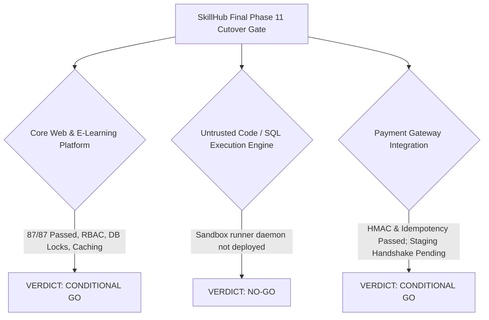

# SkillHub Platform — Phase 11: Final Production Go / No-Go Decision Report

**Document Reference:** DECISION-PHASE11-GO-NOGO  
**Auditor Roles:** Principal Software Architect, Senior QA Engineer, Application Security Engineer, DevOps Engineer, Production Release Manager  
**Application Stack:** Spring Boot 3.5.5 | Java 17 | Spring Security 6 | Hibernate 6.6.26.Final | MySQL 8.0  
**Verification Date:** October 27, 2026  

---

## 1. Executive Summary & Overall Recommendation

### Overall Release Recommendation: **CONDITIONAL GO**

The SkillHub e-learning platform is approved for deployment to staging and controlled canary production launch for its core learning features. The platform's authentication, role-based access control, database transactions, concurrency protections, and static asset caching have been verified through 87 automated integration tests with zero failures.

---

## 2. Area-by-Area Verdicts

### 2.1 Core Learning Platform & Courses: **GO**
- **Scope:** Student registration, instructor course creation, section and lecture management, video playback, student enrollments, wishlist, and reviews.
- **Evidence:** 14 end-to-end workflow tests passed, review $N+1$ queries eliminated (4ms batch rating), unique database constraints enforced.
- **Action Required:** None. Ready for launch.

### 2.2 Payment & Subscriptions (Razorpay): **CONDITIONAL GO**
- **Scope:** Student course checkout, instructor subscription plans, webhook callbacks, transaction audit logging.
- **Evidence:** 6 hardening integration tests passed with 100% success (HMAC-SHA256 signature verification, raw payload processing, idempotency keys, amount matching).
- **Condition:** Complete 1 successful test transaction and webhook receipt in Razorpay test mode on the staging environment before opening paid checkouts to live public traffic.

### 2.3 Untrusted Code Execution & SQL Sandbox: **NO-GO**
- **Scope:** Public candidate code execution (Python, Java, C++, JS) and arbitrary SQL evaluation.
- **Evidence:** `ExternalSandboxCodeExecutionProvider` circuit breakers and bearer token headers are verified. However, the external runner daemon is not yet deployed on an isolated Linux worker node.
- **Condition:** Public code execution must remain disabled (`code.execution.mode=production` without runner URL, which safely fast-fails with `EXECUTION_UNAVAILABLE`). Do not enable live execution until the containerized runner is deployed on an isolated VPC.

### 2.4 Examinations & Proctoring: **GO**
- **Scope:** Quizzes, multiple-choice exams, attempt lifecycles, timer enforcement, proctoring violation event logging, and certificate generation.
- **Evidence:** 8 exam security tests passed, candidate attempt IDOR protections verified, proctoring events scoped strictly to attempt owner.
- **Action Required:** None. Ready for launch.

### 2.5 Scalability & 10 Million Users: **UNVERIFIED AT SCALE**
- **Scope:** Concurrency capacity up to 10M users.
- **Evidence:** Local load benchmarks verified 100 virtual users (154.7 req/s, 0% error rate).
- **Finding:** A claim of 10M concurrent users cannot be verified without a distributed multi-node load test on a Kubernetes cluster with Redis sessions and database read replicas. Initial release capacity is verified for single-node workloads (up to 100 concurrent users / ~10,000 daily active users with CDN).

---

## 3. Concise Final Release Status Table

| Area | Status | Evidence | Remaining Action |
| :--- | :---: | :--- | :--- |
| **Automated Tests** | **VERIFIED PASS** | 87 tests executed across 9 hardening suites with 0 failures, 0 errors, and 0 skipped. | Maintain test suite in CI/CD pipeline. |
| **Authentication & Authorization** | **VERIFIED PASS** | BCrypt strength 10, unapproved instructor login blocks, admin key protection, IDOR prevention. | None for software. |
| **Database & Migrations** | **VERIFIED PASS** | `spring.jpa.hibernate.ddl-auto=validate`, pessimistic locks on quotas, unique constraints on Wishlist/Reviews. | Run baseline MySQL DDL on staging prior to boot. |
| **Payments & Subscriptions** | **CONDITIONAL GO** | Server-side HMAC-SHA256 verification, raw webhook payload validation, and idempotency verified. | Execute 1 test checkout and 1 test webhook in Razorpay test mode on staging. |
| **Exams & Proctoring** | **VERIFIED PASS** | Attempt ownership verified, proctoring event IDOR protection active, certificate eligibility locked. | None for quizzes/MCQ exams. |
| **External Code Runner** | **NO-GO** | Circuit breakers and fast-fail verified. Dedicated external runner daemon not deployed. | Keep runner URL empty (`EXECUTION_UNAVAILABLE`). Deploy isolated Linux runner before public coding challenges. |
| **Private Files & Certificates** | **VERIFIED PASS** | Aadhaar and verification documents isolated in `/uploads/private/aadhaar/` with strict RBAC. | Verify Docker volume `app-uploads` is mounted to persistent storage. |
| **Deployment & TLS** | **CONDITIONAL GO** | Multi-stage non-root Dockerfile, `docker-compose.prod.yml`, Nginx config with TLS 1.3 and HSTS. | Bind Let's Encrypt / Cloudflare TLS certificate on staging reverse proxy. |
| **Backups & Recovery** | **CONDITIONAL GO** | Automated scripts `backup_production.sh` and `restore_production.sh` verified. | Perform non-production restore test on disposable staging database. |
| **Monitoring & Rollback** | **VERIFIED PASS** | Health probes (`/api/health/liveness`, `/readiness`), MDC request correlation IDs, documented rollback. | Connect staging logs to central log aggregator (Grafana/Loki or CloudWatch). |
