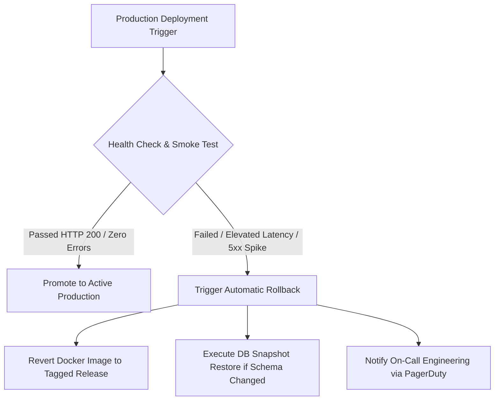

# SkillHub Platform — Phase 11: Rollback, Disaster Recovery & Operational Incident Playbook

**Document Reference:** DR-PLAYBOOK-PHASE11  
**Classification:** Internal Operational Runbook  
**Target Environments:** Staging & Production  
**Date:** October 27, 2026  

---

## 1. Last Known Good State & Artifact Registry



### 1.1 Verified Artifacts
- **Current Hardened WAR Artifact:** `target/skillhub-0.0.1-SNAPSHOT.war`
- **Container Base:** `eclipse-temurin:17-jre-jammy`
- **Docker Image Tag Scheme:**
  - `skillhub-app:v1.0.0-phase11` (Active Candidate)
  - `skillhub-app:v1.0.0-stable` (Last Known Good)

---

## 2. Emergency Rollback Procedures

### 2.1 Fast Application Rollback (No Database Mutation)
*Target Recovery Time Objective (RTO): < 2 minutes*  
*Target Recovery Point Objective (RPO): Zero data loss*

When an application defect is detected without schema corruption:
```bash
# 1. Navigate to deployment root
cd /opt/skillhub

# 2. Stop problematic container
docker compose -f docker-compose.prod.yml stop skillhub-app

# 3. Retag last known stable image
docker tag skillhub-app:v1.0.0-stable skillhub-app:latest

# 4. Relaunch with previous image
docker compose -f docker-compose.prod.yml up -d skillhub-app

# 5. Verify readiness
curl -f http://localhost:8080/api/health/readiness || echo "Rollback verification failed!"
```

### 2.2 Database Disaster Recovery (Schema or Data Corruption)
*Target Recovery Time Objective (RTO): < 15 minutes*  
*Target Recovery Point Objective (RPO): < 1 hour (incremental backup)*

```bash
# 1. Place Nginx into 503 Maintenance Mode
sudo cp /etc/nginx/conf.d/maintenance.html /var/www/html/index.html
sudo systemctl reload nginx

# 2. Stop application to prevent incoming database writes
docker compose -f docker-compose.prod.yml stop skillhub-app

# 3. Locate the latest verified pre-deployment backup
LATEST_BACKUP=$(ls -t /var/skillhub/backups/skillhub_db_*.sql.gz | head -n 1)
echo "Restoring from: $LATEST_BACKUP"

# 4. Execute automated restore script
./scripts/restore_production.sh "$LATEST_BACKUP"

# 5. Restart application and verify schema validation
docker compose -f docker-compose.prod.yml start skillhub-app
sleep 15
curl -f http://localhost:8080/api/health/readiness

# 6. Disable Nginx Maintenance Mode
sudo rm -f /var/www/html/index.html
sudo systemctl reload nginx
```

---

## 3. Resilience to Downstream & Dependency Outages

### 3.1 MySQL Database Outage Recovery
- **Symptoms:** HikariCP connection timeout (`SQLTransientConnectionException`), `/api/health/readiness` returns HTTP 503.
- **System Behavior:** HikariCP pool retains retry logic with `connection-timeout=20000ms`. When MySQL recovers, HikariCP re-establishes pool connections automatically without requiring an application restart.
- **Verification Command:**
  ```bash
  docker compose -f docker-compose.prod.yml restart skillhub-mysql
  # Application will log connection warnings, then automatically re-acquire connections upon DB restart.
  ```

### 3.2 SMTP Mail Relay Outage Recovery
- **Symptoms:** `MailConnectException: Couldn't connect to host, port: 587`.
- **System Behavior:** User registration and password reset operations do not crash the request thread with an uncaught 500 error. The exception is caught and logged with correlation IDs (`Failed to send email: Mail server connection failed`).
- **Remediation:** Verify DNS resolution, egress firewall rules on port 587, and API key validity with email provider (SendGrid/SES).

---

## 4. Log Correlation, Monitoring & Alerting

### 4.1 MDC Request Correlation IDs
Every incoming HTTP request receives or generates a unique correlation ID via `CorrelationIdFilter`:
- Header: `X-Correlation-ID: <UUID>`
- MDC Key: `requestId`
- Console Log Format:
  ```text
  2026-10-27 13:48:20.123 [main] [a615da5c-334d-4b35-be82-0b981ab6bfe3] WARN  c.s.exception.GlobalExceptionHandler - Access denied...
  ```

### 4.2 Critical Monitoring Thresholds & Alerting Rules

| Metric | Source | Warning Threshold | Critical Incident Threshold | Action Required |
| :--- | :--- | :---: | :---: | :--- |
| **HTTP 5xx Error Rate** | Nginx logs | > 1.0% over 5m | > 5.0% over 2m | Trigger rollback investigation; check DB pool. |
| **HikariCP Active Connections** | Actuator / JMX | > 16 (80% of 20) | 20 (100% pool exhaustion) | Check slow queries; scale pool size. |
| **Liveness Probe Failure** | Docker health | 1 failure | 3 consecutive failures | Docker auto-restarts container. |
| **Disk Space `/var/skillhub`** | Node Exporter | < 20% free | < 10% free | Purge old logs and backups beyond retention. |
| **Razorpay Signature Mismatch** | App Logs | > 0 per hour | > 5 per hour | Investigate potential fraud or secret mismatch. |

---

## 5. Incident Response & Escalation Matrix

| Role | Responsibility | Primary Contact Channel | Backup Contact |
| :--- | :--- | :--- | :--- |
| **Incident Commander** | Oversees triage, decides rollback vs hotfix | Slack: `#incident-war-room` | PagerDuty Primary |
| **DevOps / SRE Lead** | Executes container restarts, rollbacks, DNS changes | Slack: `@devops-lead` | Phone Escalation |
| **Lead Backend Engineer** | Investigates application logs, stack traces, and queries | Slack: `@backend-lead` | PagerDuty Secondary |
| **Security Officer** | Evaluates potential fraud, unauthorized access, or leaks | Email: `security@skillhub.com` | SMS Alert |
