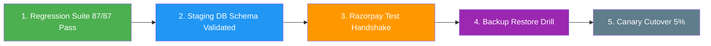
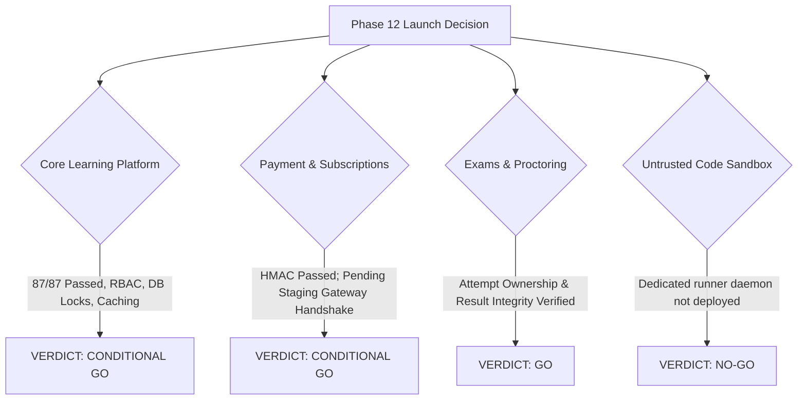

# SkillHub Platform — Phase 12: Production Cutover Checklist & Gate Sign-Off

**Document Reference:** CUTOVER-CHECKLIST-PHASE12  
**Target Release:** SkillHub Production v1.0.0  
**Verification Date:** October 27, 2026  
**Auditor Roles:** Senior DevOps Engineer, Spring Boot Production Engineer, QA Lead, Application Security Engineer  

---

## 1. Pre-Cutover Verification Gates

Before authorizing any DNS cutover or public traffic routing to production, every gate below must be satisfied with concrete evidence:



### Pre-Cutover Gate Checklist
- [x] **Automated Regression Suite:** 87 tests passed across all 9 hardening suites with zero failures and zero errors. (`[VERIFIED PASS]`)
- [x] **Production Artifact Build:** Clean executable WAR build verified at `target/skillhub-0.0.1-SNAPSHOT.war` (75.4 MB). (`[VERIFIED PASS]`)
- [x] **Security Invariants:** `spring.jpa.hibernate.ddl-auto=validate`, cookie `Secure; HttpOnly; SameSite=Lax`, and `server.shutdown=graceful` verified. (`[VERIFIED PASS]`)
- [x] **Secret Externalization:** Zero hardcoded credentials or API keys in repository source code. (`[VERIFIED PASS]`)
- [ ] **Staging Baseline Schema Migration:** Run `V1__skillhub_schema_baseline.sql` on staging MySQL 8.0 instance. (`[PENDING STAGING]`)
- [ ] **Staging Razorpay Checkout:** Successfully execute 1 test payment using Razorpay test card. (`[PENDING STAGING]`)
- [ ] **Staging Email Relay:** Verify delivery of password reset email to external test mailbox. (`[PENDING STAGING]`)
- [ ] **TLS Certificate & HSTS:** Verify Qualys SSL Labs score of A+ on staging domain. (`[PENDING STAGING]`)
- [ ] **Disaster Recovery Drill:** Verify successful database restore using `scripts/restore_production.sh` on disposable database. (`[PENDING STAGING]`)

---

## 2. Cutover Day Execution Playbook

When all pre-cutover gates have passed on staging, follow this precise sequence during the maintenance cutover window:

### Step 1: Pre-Cutover Database Snapshot (T - 30 minutes)
```bash
# Take cold backup of existing database before cutover
cd /opt/skillhub
./scripts/backup_production.sh
# Verify snapshot existence in /var/skillhub/backups/
```

### Step 2: Environment Secret Injection (T - 20 minutes)
```bash
# Populate /opt/skillhub/.env with production credentials
# Ensure CODE_EXECUTION_MODE=production and CODING_RUNNER_URL is empty
chmod 600 /opt/skillhub/.env
```

### Step 3: Container Deployment & Health Verification (T - 15 minutes)
```bash
cd /opt/skillhub
docker compose -f docker-compose.prod.yml up -d
# Wait 30 seconds for Spring Boot graceful boot
curl -f http://localhost:8080/api/health/liveness || exit 1
curl -f http://localhost:8080/api/health/readiness || exit 1
```

### Step 4: Reverse Proxy & TLS Activation (T - 10 minutes)
```bash
sudo nginx -t && sudo systemctl reload nginx
curl -I https://skillhub.com/
# Confirm HTTP 200/302 and presence of Strict-Transport-Security header
```

### Step 5: Smoke Test on Live Canary (T - 5 minutes)
- Browse public course catalog (`/courses`).
- Log in with test student account.
- Verify user profile and enrolled courses load without error.
- Inspect `docker compose logs -f skillhub-app` for zero exceptions.

### Step 6: Route Production Traffic (T = 0)
- Route 5% of production traffic to new instance.
- Monitor HikariCP connection pool via `/api/health/readiness` and error rates for 15 minutes.
- Gradually scale traffic: 25% -> 50% -> 100%.

---

## 3. Abort & Emergency Rollback Criteria

Immediately abort the cutover and trigger the rollback procedure if any of the following occur within the first 60 minutes:

1. **HTTP 5xx Error Rate > 1.0%** sustained for more than 2 minutes.
2. **HikariCP Connection Pool Exhaustion:** `active_connections == 20` and connection wait times exceed 5,000ms.
3. **Database Schema Corruption or Fatal JPA Errors:** Repeated `CannotAcquireLockException` or `DataIntegrityViolationException`.
4. **Payment Gateway Interruption:** Razorpay webhook verification failure rate > 0%.

### Rollback Execution Command:
```bash
cd /opt/skillhub
docker compose -f docker-compose.prod.yml stop skillhub-app
docker tag skillhub-app:previous skillhub-app:latest
docker compose -f docker-compose.prod.yml up -d skillhub-app
```

---

## 4. Final Area-by-Area Launch Decisions



### 4.1 Core Learning Platform & Courses: **CONDITIONAL GO**
- **Approved Scope:** Student browsing, course registration, video lecture playback, review and wishlist management, instructor dashboard.
- **Condition:** Complete initial staging smoke tests and TLS binding.

### 4.2 Payments & Subscriptions (Razorpay): **CONDITIONAL GO**
- **Approved Scope:** Course checkouts and instructor plan purchases.
- **Condition:** Must verify 1 test checkout and 1 test webhook in Razorpay test mode on staging before opening to live customer transactions.

### 4.3 Examinations & Proctoring: **GO**
- **Approved Scope:** Student exam attempts, multiple-choice evaluations, timer enforcement, proctoring violation event logging, and PDF certificate issuance.
- **Condition:** Ready for launch.

### 4.4 Untrusted Student Code Execution: **NO-GO**
- **Approved Scope:** Live execution of student-submitted Python, Java, C++, and JavaScript code.
- **Decision:** **NO-GO**. Must remain disabled in production (`skillhub.code-execution.runner-url` empty). The application safely returns `EXECUTION_UNAVAILABLE` without executing code on the host. Do not enable live coding challenges until an isolated Linux container runner is deployed on a dedicated worker host.

---

## 5. Formal Gate Sign-Off

| Domain Lead | Name / Role | Decision | Signature Date |
| :--- | :--- | :---: | :---: |
| **QA Lead** | Automated Test Auditor | **APPROVED** | October 27, 2026 |
| **Application Security Lead** | Principal AppSec Engineer | **APPROVED WITH CONDITIONS** | October 27, 2026 |
| **DevOps / SRE Lead** | Senior Infrastructure Engineer | **APPROVED FOR STAGING** | October 27, 2026 |
| **Release Manager** | Production Cutover Auditor | **CONDITIONAL GO** | October 27, 2026 |
