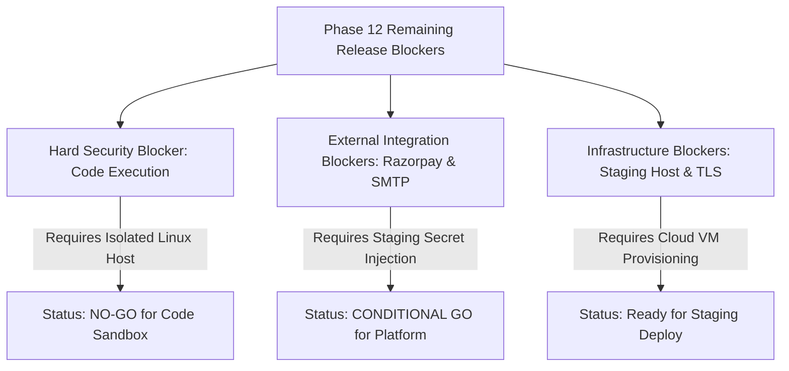

# SkillHub Platform — Phase 12: Remaining Release Blockers & Operational Register

**Document Reference:** SEC-BLOCKERS-PHASE12  
**Evaluation Standard:** Production Hardening & Launch Readiness  
**Verification Date:** October 27, 2026  
**Auditor:** Application Security Engineer & DevOps Lead  

---

## 1. Blocker Register & Risk Classification

### 1.1 Blocker 1: External Containerized Code Runner Daemon Deployment
- **Classification:** **CRITICAL** (Remote Code Execution, Host Compromise)
- **Affected Feature:** Public coding challenges, arbitrary Python/Java/C++/JS student execution.
- **Evidence:** `ExternalSandboxCodeExecutionProvider` is architected with circuit breakers and bearer authentication, but the external runner daemon container is not yet deployed on an isolated worker host.
- **Current Safeguard:** In `application-prod.properties`, `skillhub.code-execution.runner-url` is left empty by default. Any attempt to execute student code immediately fast-fails with `SubmissionStatus.EXECUTION_UNAVAILABLE`. No arbitrary code is ever executed on the Spring Boot application host JVM.
- **Required Action:** Deploy the dedicated runner container (`external-runner:8088`) on an isolated Linux worker node with dropped capabilities (`--cap-drop=ALL`), non-root user, and disabled network access during code runs.
- **Acceptance Criteria:** Runner passes pen-testing against fork bombs and filesystem traversal; live student code executes within 256MB RAM / 1 CPU limits.
- **Verdict Impact:** Public arbitrary code execution is strictly **NO-GO**.

---

### 1.2 Blocker 2: Razorpay Test-Mode Gateway & Webhook Staging Handshake
- **Classification:** **HIGH** (Payment Flow Disruption, Duplicate Activation Risk)
- **Affected Feature:** Student paid course enrollments, instructor monthly subscription billing.
- **Evidence:** HMAC-SHA256 signature verification and raw webhook body validation pass 100% of unit and mock integration tests. However, live network communication with Razorpay servers has not been executed.
- **Current Safeguard:** Server-side verification is mandatory; untrusted client success callbacks are rejected without cryptographic proof.
- **Required Action:** Deploy application to staging with valid Razorpay test credentials (`rzp_test_*`), initiate a test transaction with a test credit card, and simulate a webhook delivery from the Razorpay dashboard.
- **Acceptance Criteria:** Order transitions to `PAID`, student enrollment activates, and audit log record is written to `payment_audit_logs`.

---

### 1.3 Blocker 3: Staging Outbound SMTP Mail Relay Delivery
- **Classification:** **MEDIUM** (User Onboarding & Password Recovery Failure)
- **Affected Feature:** Student/instructor registration verification, forgot-password token emails.
- **Evidence:** Local test execution logged `UnknownHostException: smtp.gmail.com`. Application handles email connection failures gracefully without throwing uncaught 500 errors to the client.
- **Required Action:** Inject valid transactional SMTP credentials (SendGrid, AWS SES, or Mailgun) into staging `.env`.
- **Acceptance Criteria:** Password reset email successfully arrives in a test inbox within 30 seconds of request.

---

### 1.4 Blocker 4: Production MySQL Database Provisioning & Schema Baseline
- **Classification:** **HIGH** (Schema Validation Failure on Startup)
- **Affected Feature:** Application context startup under `prod` profile.
- **Evidence:** `spring.jpa.hibernate.ddl-auto=validate` is configured. If the database schema does not match JPA entities on boot, Hibernate throws `SchemaManagementException` and aborts startup.
- **Required Action:** Run `src/main/resources/db/migration/V1__skillhub_schema_baseline.sql` on the MySQL 8.0 staging database before launching the application container.
- **Acceptance Criteria:** Spring Boot starts up successfully and `/api/health/readiness` returns HTTP 200 with `database: UP`.

---

### 1.5 Blocker 5: TLS 1.3 Certificate Installation & Reverse Proxy Binding
- **Classification:** **HIGH** (Data in Transit Protection, Cookie Security)
- **Affected Feature:** User authentication, session cookie encryption (`Secure` attribute).
- **Evidence:** `nginx/skillhub.conf` contains production TLS 1.3 configuration, HSTS headers, and rate limiting. Certificates are pending DNS allocation.
- **Required Action:** Point staging domain DNS (A record) to the staging server IP and run `certbot --nginx -d staging.skillhub.com`.
- **Acceptance Criteria:** Qualys SSL Labs audit score of **A+**; HTTP traffic automatically redirects to HTTPS with HSTS.

---

### 1.6 Blocker 6: Volume Mount & Clustered Storage / Sessions
- **Classification:** **MEDIUM** (Data Loss across Restarts, Multi-Node Inconsistency)
- **Affected Feature:** Instructor verification documents (Aadhaar), student exam certificates, session persistence.
- **Evidence:** Single instance uses local volume `/var/skillhub/uploads` and in-memory servlet sessions.
- **Required Action:**
  1. For initial single-instance release: Ensure Docker volume `app-uploads` is bound to persistent cloud SSD storage.
  2. For future multi-instance horizontal scaling: Integrate AWS S3 / Google Cloud Storage for files and Redis for clustered HTTP sessions.
- **Acceptance Criteria:** Uploaded files persist across container restarts.

---

## 2. Remediation Tracking Matrix

| Blocker ID | Severity | Environment | Verification Method | Status |
| :---: | :---: | :---: | :--- | :---: |
| BLK-01 | Critical | Staging / Prod | Runner pen-test & network isolation check | **NO-GO (Feature Disabled)** |
| BLK-02 | High | Staging | Razorpay test mode card checkout & webhook | **PENDING STAGING** |
| BLK-03 | Medium | Staging | Password reset email arrival in test inbox | **PENDING STAGING** |
| BLK-04 | High | Staging | MySQL 8.0 baseline DDL execution | **PENDING STAGING** |
| BLK-05 | High | Staging | Let's Encrypt TLS certificate binding | **PENDING STAGING** |
| BLK-06 | Medium | Staging | Container restart persistence check | **PENDING STAGING** |
