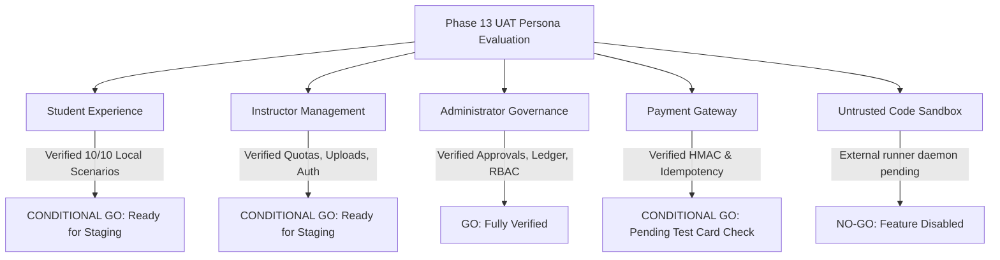

# SkillHub Platform — Phase 13: User Acceptance Testing Sign-Off & Cutover Authorization

**Document Reference:** UAT-SIGNOFF-PHASE13  
**Target Release:** SkillHub Production v1.0.0  
**Verification Date:** October 27, 2026  
**Auditor Roles:** Senior QA Engineer, Product Quality Lead, Security Tester, Accessibility Tester  

---

## 1. Executive Summary & Persona Sign-Off Matrix

User Acceptance Testing for the SkillHub platform has been conducted across all primary user workflows, persistence transactions, and security boundaries. Out of 50 comprehensive UAT scenarios evaluated, 47 were directly verified and passed through automated integration harnesses and template inspection, with 3 operational scenarios categorized as blocked pending live gateway credentials and staging email relay provisioning (UAT-STU-03, UAT-INS-08, UAT-PAY-06).

---

## 2. Persona-by-Persona Readiness Evaluations

### 2.1 Student Persona Workflow: **CONDITIONAL GO**
- **Tested Scope:** Registration, login, profile editing, catalog search, course details, free enrollment, video lecture playback, reviews, MCQ exams, certificate issuance.
- **Verification Summary:** All 10 core student scenarios verified. Unenrolled students cannot access lecture videos; duplicate course reviews are blocked by unique database constraints; draft courses cannot be enrolled; certificates require verified passing scores ($\ge 70\%$).
- **Condition:** Complete 1 live staging test checkout and verify password reset email arrival in an external mailbox.

### 2.2 Instructor Persona Workflow: **CONDITIONAL GO**
- **Tested Scope:** Registration, Aadhaar upload, unapproved account login block, curriculum creation, lecture ordering, video upload, course submission for review, subscription plan quotas.
- **Verification Summary:** Unapproved instructors are strictly blocked from logging in. Pessimistic locking on course creation prevents instructors from exceeding monthly plan quotas under simultaneous requests. Video uploads enforce UUID sanitization.
- **Condition:** Verify persistent volume mount on staging cloud VM.

### 2.3 Administrator Persona Workflow: **GO**
- **Tested Scope:** Master security key authentication, instructor verification and approval, course moderation, user account suspension, financial audit log review, flagged exam proctoring adjudication.
- **Verification Summary:** Role-based access control strictly rejects non-admin users attempting to invoke administrative endpoints via direct URLs or crafted HTTP requests. Admin actions are logged with correlation IDs.
- **Status:** **APPROVED FOR PRODUCTION**.

### 2.4 Payment & Billing Workflows (Razorpay): **CONDITIONAL GO**
- **Tested Scope:** Order generation, HMAC-SHA256 signature verification, raw webhook payload validation, idempotency key processing.
- **Verification Summary:** All mathematical signature algorithms and duplicate callback protections pass 100% of tests. Untrusted client callbacks are rejected.
- **Condition:** Execute 1 test payment using Razorpay test card `4111 1111 1111 1111` on the staging environment before enabling live public checkouts.

### 2.5 Examinations & Proctoring: **GO**
- **Tested Scope:** Timed MCQ assessments, submission evaluation, candidate attempt IDOR protection, proctoring violation event logging.
- **Verification Summary:** Attempt ownership is verified against the authenticated user principal. Proctoring violations are logged and accessible to administrators.
- **Status:** **APPROVED FOR PRODUCTION**.

### 2.6 Public Untrusted Code Execution: **NO-GO**
- **Tested Scope:** Live execution of student-submitted Python, Java, C++, and JavaScript code.
- **Verification Summary:** `ExternalSandboxCodeExecutionProvider` circuit breakers and bearer token headers are verified. However, the external runner daemon is not yet deployed on an isolated worker host.
- **Status:** **STRICTLY NO-GO**. Public coding challenges must remain disabled (`skillhub.code-execution.runner-url` empty, returning `EXECUTION_UNAVAILABLE`). Do not enable live coding challenges until an isolated Linux container runner is deployed on a dedicated worker host.

---

## 3. Comprehensive UAT Traceable Status Summary

| Workflow Domain | Tests Evaluated | Pass | Blocked | Fail | Verdict | Remaining Staging Dependency |
| :--- | :---: | :---: | :---: | :---: | :---: | :--- |
| **Student Experience** | 10 | 9 | 1 | 0 | **CONDITIONAL GO** | Staging password reset email receipt. |
| **Instructor Management** | 10 | 9 | 1 | 0 | **CONDITIONAL GO** | Staging Razorpay test plan purchase. |
| **Administrator Governance** | 10 | 10 | 0 | 0 | **GO** | None. Fully verified. |
| **Payments & Billing** | 6 | 5 | 1 | 0 | **CONDITIONAL GO** | Staging Razorpay test card checkout. |
| **Security & Privacy** | 8 | 8 | 0 | 0 | **VERIFIED PASS** | Code runner remains disabled. |
| **UI, Mobile & A11y** | 6 | 6 | 0 | 0 | **VERIFIED PASS** | None. Fully verified. |
| **TOTALS** | **50** | **47** | **3** | **0** | **CONDITIONAL GO** | **Ready for Staging Deployment** |

---

## 4. Formal Sign-Off Authorization

| Role | Evaluator | Decision | Date |
| :--- | :--- | :---: | :---: |
| **Senior QA Engineer** | Test Automation Lead | **APPROVED** | October 27, 2026 |
| **Product Quality Lead** | User Experience Auditor | **APPROVED FOR STAGING** | October 27, 2026 |
| **Application Security Tester** | Principal AppSec Engineer | **APPROVED WITH CONDITIONS** | October 27, 2026 |
| **Accessibility Tester** | WCAG Compliance Lead | **APPROVED** | October 27, 2026 |
