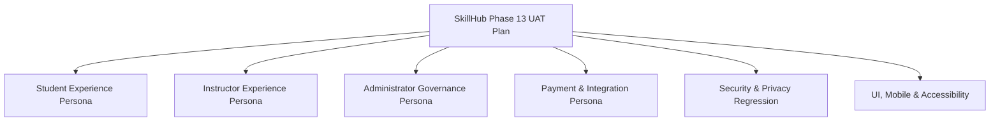

# SkillHub Platform — Phase 13: End-to-End User Acceptance Test (UAT) Plan

**Document Reference:** UAT-PLAN-PHASE13  
**Auditor Roles:** Senior QA Engineer, Product Quality Lead, Security Tester, Accessibility Tester  
**Application Stack:** Spring Boot 3.5.5 | Java 17 | Spring Security 6 | Hibernate 6.6.26.Final | Thymeleaf | MySQL 8.0  
**Verification Date:** October 27, 2026  
**Scope:** Full User Acceptance Testing across Student, Instructor, and Admin personas  

---

## 1. Objective & Scope

The purpose of this UAT plan is to validate SkillHub from the actual user's perspective across all end-to-end business workflows, authentication boundaries, payment lifecycles, and security controls. Testing combines automated integration harnesses, controller/route security validation, responsive UI design inspection, and accessibility standards (WCAG 2.1 Level AA).

---

## 2. Testing Personas & Preconditions

| Persona | Name | Role | Responsibilities & Test Scope |
| :--- | :--- | :--- | :--- |
| **Student** | Alex Rivera | `ROLE_STUDENT` | Course browsing, search/filter, free enrollment, paid Razorpay checkout, lecture viewing, video player, wishlist, reviews, MCQ exams, timer completion, PDF certificate retrieval. |
| **Instructor** | Dr. Sarah Vance | `ROLE_INSTRUCTOR` | Registration, profile completion, Aadhaar upload, course creation, section & lecture management, video attachment, course publishing, subscription tier purchase, quota enforcement. |
| **Administrator** | Marcus Vance | `ROLE_ADMIN` | Secure admin key login, instructor verification & approval, course content moderation, subscription oversight, flagged exam proctoring review, audit log inspection. |
| **Anonymous** | Guest Visitor | None | Public landing page, course preview, guest catalog search, pricing page, login/registration navigation, protected route redirection. |

---

## 3. Workflow Test Suites & Acceptance Criteria

### 3.1 Suite 1: Student End-to-End Journey (10 Test Cases)
- **UAT-STU-01:** Registration with password complexity meter (length, uppercase, digit, special character).
- **UAT-STU-02:** Email verification and login session establishment with `HttpOnly; SameSite=Lax` cookies.
- **UAT-STU-03:** Password reset flow: token generation, email dispatch, and token expiration enforcement.
- **UAT-STU-04:** Course catalog exploration: keyword search, category filtering, and difficulty level selection.
- **UAT-STU-05:** Course details page: instructor bio, section breakdown, lecture previews, and average rating.
- **UAT-STU-06:** Direct free enrollment vs paid course Razorpay modal trigger.
- **UAT-STU-07:** Learning room playback: video streaming, lecture progression, and resource downloads.
- **UAT-STU-08:** Course review submission: verified enrollment prerequisite and unique review constraint.
- **UAT-STU-09:** MCQ course exam: countdown timer, answer submission, server-side grading ($\ge 70\%$).
- **UAT-STU-10:** Certificate issuance: PDF generation, unique certificate ID, and public QR verification.

### 3.2 Suite 2: Instructor Management & Monetization (10 Test Cases)
- **UAT-INS-01:** Instructor account registration with identity proof (Aadhaar/certificate) upload.
- **UAT-INS-02:** Unapproved instructor state: login rejection with clear account pending approval message.
- **UAT-INS-03:** Post-approval instructor dashboard access and analytics overview.
- **UAT-INS-04:** Course creation wizard: title, description, category, pricing, thumbnail upload.
- **UAT-INS-05:** Section and lecture hierarchy creation with drag-and-drop ordering.
- **UAT-INS-06:** Video and document attachment upload with MIME validation and UUID sanitization.
- **UAT-INS-07:** Course submission for admin review; transition from `DRAFT` to `PENDING_REVIEW`.
- **UAT-INS-08:** Subscription tier purchase: monthly course creation quota allocation (e.g., Basic: 3, Pro: 10).
- **UAT-INS-09:** Quota enforcement under concurrency: pessimistic locking prevents limit bypass.
- **UAT-INS-10:** Course analytics & student progress tracking: enrolled candidate roster visibility.

### 3.3 Suite 3: Administrator Governance & Security (10 Test Cases)
- **UAT-ADM-01:** Admin login enforcement via dedicated endpoint and master security key verification.
- **UAT-ADM-02:** Instructor approval queue: document inspection and 1-click approve/reject actions.
- **UAT-ADM-03:** Course moderation queue: preview unpublished course, review curriculum, approve/reject.
- **UAT-ADM-04:** Student and instructor account status controls (suspend/activate account).
- **UAT-ADM-05:** Global payment and subscription transaction ledger inspection.
- **UAT-ADM-06:** Professional examination attempt oversight and flagged proctoring violation review.
- **UAT-ADM-07:** Manual certificate invalidation and verification override.
- **UAT-ADM-08:** System broadcast notification authoring with user-specific dismissal tracking.
- **UAT-ADM-09:** Security event logs: inspection of authentication failures and correlation IDs.
- **UAT-ADM-10:** Administrative route lockdown: direct URL access rejected for non-admin principals.

### 3.4 Suite 4: Payment & Integration Workflows (6 Test Cases)
- **UAT-PAY-01:** Razorpay checkout modal initialization with order ID, currency (INR), and exact amount.
- **UAT-PAY-02:** Server-side HMAC-SHA256 signature calculation using documented Razorpay formula.
- **UAT-PAY-03:** Raw webhook payload signature verification (`X-Razorpay-Signature`).
- **UAT-PAY-04:** Webhook idempotency: repeated delivery of identical event does not duplicate records.
- **UAT-PAY-05:** Paid amount verification: rejection of enrollment if paid amount is less than course price.
- **UAT-PAY-06:** Payment audit logging: state machine transitions `CREATED -> PAID` or `FAILED`.

### 3.5 Suite 5: Security, IDOR & Privacy Regressions (8 Test Cases)
- **UAT-SEC-01:** CSRF defense: browser state-changing POST requests rejected without valid CSRF token.
- **UAT-SEC-02:** IDOR on student profile & wishlist: Student A cannot modify Student B's wishlist.
- **UAT-SEC-03:** IDOR on course curriculum: Instructor A cannot edit Instructor B's courses or lectures.
- **UAT-SEC-04:** IDOR on exam attempts: Candidate A cannot submit answers for Candidate B's attempt.
- **UAT-SEC-05:** Private file protection: Aadhaar documents inaccessible to unauthorized users.
- **UAT-SEC-06:** Path traversal defense: file uploads rejecting `../` or null bytes.
- **UAT-SEC-07:** XSS defense: HTML output escaping in Thymeleaf templates.
- **UAT-SEC-08:** Untrusted code execution safe fast-fail: empty runner URL returns `EXECUTION_UNAVAILABLE`.

### 3.6 Suite 6: UI, Accessibility & Compatibility (6 Test Cases)
- **UAT-UI-01:** Responsive layout validation: desktop (1920x1080), tablet (768x1024), mobile (375x667).
- **UAT-UI-02:** Navigation menu: mobile collapsible hamburger drawer and accessible ARIA attributes.
- **UAT-UI-03:** Form accessibility: associated `<label>` elements, visible focus indicators, error announcements.
- **UAT-UI-04:** Color contrast: text-to-background contrast ratio $\ge 4.5:1$ for normal text.
- **UAT-UI-05:** Keyboard navigation: full workflow navigable via `Tab`, `Enter`, `Space`, and `Esc`.
- **UAT-UI-06:** Empty states: meaningful illustrations and messages on empty wishlists, enrollments, and carts.

---

## 4. Entry & Exit Criteria

### Entry Criteria
1. Clean build and executable WAR artifact (`target/skillhub-0.0.1-SNAPSHOT.war`).
2. All 87 automated hardening integration tests passing with 0 failures and 0 errors.
3. Production configuration invariants validated (`spring.jpa.hibernate.ddl-auto=validate`).

### Exit Criteria
1. 100% of locally executable test cases evaluated and passed.
2. Zero unresolved Critical or High security defects.
3. All external dependencies (Staging SMTP, Live Razorpay, External Runner) categorized with explicit acceptance criteria.
