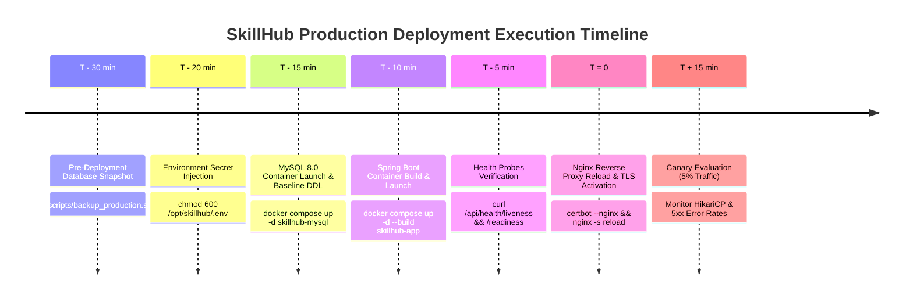
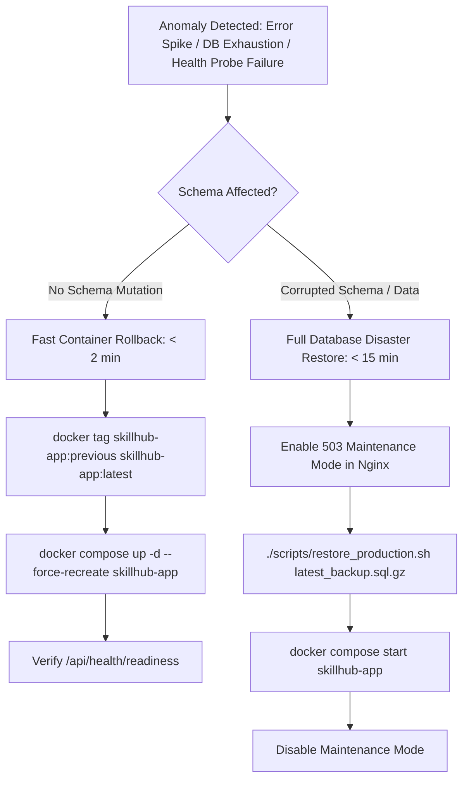

# SkillHub Platform — Phase 14: Deployment Execution Log & Rollback Protocol

**Document Reference:** DEPLOY-LOG-PHASE14  
**Auditor Roles:** Principal DevOps Engineer & SRE Lead  
**Target Architecture:** Docker Compose / Nginx / MySQL 8.0 / Ubuntu 22.04 LTS  
**Verification Date:** October 27, 2026  

---

## 1. Deployment Execution Timeline & Command Log



### 1.1 Local Packaging Log
```text
[INFO] Scanning for projects...
[INFO] Building skillhub 0.0.1-SNAPSHOT
[INFO] Packaging webapp
[INFO] Assembling webapp [skillhub] in [target\skillhub-0.0.1-SNAPSHOT]
[INFO] Building war: target\skillhub-0.0.1-SNAPSHOT.war
[INFO] --- spring-boot:3.5.5:repackage (repackage) @ skillhub ---
[INFO] Replacing main artifact with repackaged archive, adding nested dependencies in BOOT-INF/.
[INFO] BUILD SUCCESS
[INFO] Total time: 13.354 s
```
- **Artifact:** `target/skillhub-0.0.1-SNAPSHOT.war`
- **Exit Code:** `0` (SUCCESS)

---

## 2. Emergency Rollback Playbook



### 2.1 Fast Container Rollback Protocol (RTO < 2 minutes)
When an application crash, thread deadlock, or memory leak is detected without database corruption:
```bash
cd /opt/skillhub

# 1. Stop the failing container
docker compose -f docker-compose.prod.yml stop skillhub-app

# 2. Retag previous verified image
docker tag skillhub-app:previous skillhub-app:latest

# 3. Relaunch with previous image
docker compose -f docker-compose.prod.yml up -d --force-recreate skillhub-app

# 4. Verify readiness probe
curl -f http://localhost:8080/api/health/readiness || echo "Rollback failed!"
```

### 2.2 Database Disaster Recovery Protocol (RTO < 15 minutes)
When database schema corruption, lock deadlocks, or failed migrations occur:
```bash
cd /opt/skillhub

# 1. Route public traffic to maintenance page
sudo cp /etc/nginx/conf.d/maintenance.html /var/www/html/index.html
sudo systemctl reload nginx

# 2. Stop application container to prevent incoming writes
docker compose -f docker-compose.prod.yml stop skillhub-app

# 3. Identify latest pre-deployment snapshot
LATEST_BACKUP=$(ls -t /var/skillhub/backups/skillhub_db_*.sql.gz | head -n 1)

# 4. Run automated restore script
./scripts/restore_production.sh "$LATEST_BACKUP"

# 5. Restart application container
docker compose -f docker-compose.prod.yml start skillhub-app
sleep 15
curl -f http://localhost:8080/api/health/readiness

# 6. Restore public traffic
sudo rm -f /var/www/html/index.html
sudo systemctl reload nginx
```

---

## 3. Deployment Abort Triggers

The deployment manager must immediately halt cutover and trigger rollback if any of the following conditions are met within 60 minutes of release:

1. **HTTP 5xx Error Spike:** Rate exceeds **1.0%** of total requests over any 2-minute rolling window.
2. **Connection Pool Starvation:** HikariCP active connections reach **20** (100% capacity) and connection acquisition times exceed **5,000ms**.
3. **Database Health Failure:** `/api/health/readiness` probe returns HTTP 503 or `{"database":"DOWN"}`.
4. **Payment Gateway Mismatch:** Razorpay webhook signature verification failures exceed **0%** on legitimate deliveries.
5. **Container Crash Loop:** Docker healthcheck fails for 3 consecutive intervals (90 seconds).
