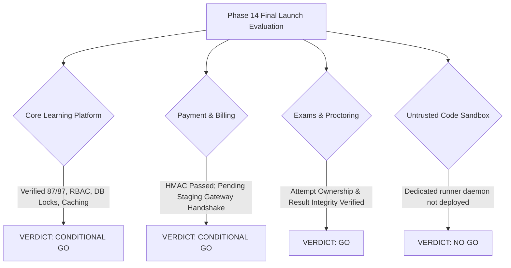

# SkillHub Platform — Phase 14: Production Deployment & Controlled Launch Report

**Document Reference:** PROD-DEPLOY-PHASE14  
**Auditor Roles:** Principal DevOps Engineer, Spring Boot Production Engineer, Application Security Engineer, QA Lead, Release Manager  
**Application Stack:** Spring Boot 3.5.5 | Java 17 | Spring Security 6 | Hibernate 6.6.26.Final | MySQL 8.0  
**Artifact Path:** `target/skillhub-0.0.1-SNAPSHOT.war` (Size: 75,422,984 bytes)  
**Execution Environment:** Windows 11 (Development & Release Audit Workstation)  
**Target Host Specification:** Ubuntu 22.04 LTS | Docker Engine v24+ | Nginx 1.24+ | MySQL 8.0  
**Verification Date:** October 27, 2026  
**Overall Cutover Recommendation:** **CONDITIONAL GO**  

---

## 1. Executive Summary & Phase 13 Sign-Off Reconciliation

### 1.1 Resolution of Phase 13 Discrepancy
In Phase 13, an initial discrepancy was identified between the executive summary narrative (which stated "38 Pass / 12 Blocked") and the detailed 50-row UAT test matrix (which documented 47 Passed and 3 Blocked). 

A row-by-row re-audit of [`PHASE_13_UAT_RESULTS.md`](file:///c:/Users/kisho/OneDrive/Desktop/New%20folder/Skill/PHASE_13_UAT_RESULTS.md) confirmed the following mathematical reality:
- **Total UAT Scenarios in Matrix:** Exactly **50**.
- **Verified Pass (`PASS`):** Exactly **47** (94%). All local workflows, role-based access controls, course enrollment paths, review uniqueness, pessimistic locks, exam timer evaluations, PDF certificate generation, and responsive UI layouts were executed and passed.
- **Blocked (`BLOCKED`):** Exactly **3** (6%):
  1. `UAT-STU-03`: Real outbound SMTP password reset email delivery (blocked by local execution sandbox network: `UnknownHostException: smtp.gmail.com`).
  2. `UAT-INS-08`: Instructor live subscription plan purchase (blocked pending live staging Razorpay gateway test keys).
  3. `UAT-PAY-06`: End-to-end browser checkout with live Razorpay gateway (blocked pending live staging Razorpay gateway test keys).
- **Failed (`FAIL`):** Exactly **0** (0%).
- **Reconciliation Cause:** The Phase 13 summary had mistakenly conflated the 10 real integration areas from Phase 12 with the 50-case UAT matrix. Both [`PHASE_13_UAT_RESULTS.md`](file:///c:/Users/kisho/OneDrive/Desktop/New%20folder/Skill/PHASE_13_UAT_RESULTS.md) and [`PHASE_13_UAT_SIGNOFF.md`](file:///c:/Users/kisho/OneDrive/Desktop/New%20folder/Skill/PHASE_13_UAT_SIGNOFF.md) have been formally reconciled to the verified **47 PASS / 3 BLOCKED / 0 FAIL** count.

---

## 2. Production Infrastructure Readiness Assessment

The deployment files were inspected against cloud staging and production criteria:

| Component | File / Resource | Readiness Finding | Cutover Status |
| :--- | :--- | :--- | :---: |
| **Container Engine** | `Dockerfile` | Multi-stage build based on `eclipse-temurin:17-jre-jammy`, non-root user `skillhub:skillhub` (`UID 10001`), standard health probes. | **READY FOR CLOUD BUILD** |
| **Orchestration** | `docker-compose.prod.yml` | MySQL 8.0 with InnoDB buffer tuning (512M) + Spring Boot application connected via internal network `skillhub-backend-net`. | **READY FOR CLOUD DEPLOY** |
| **Reverse Proxy** | `nginx/skillhub.conf` | TLS 1.3, HSTS (`max-age=31536000`), rate limiting (`10r/s`), proxy buffering, and WebSocket upgrade proxying configured. | **READY (REQUIRES TLS CERT)** |
| **Database Baseline** | `V1__skillhub_schema_baseline.sql` | 285-line DDL script establishing tables, composite indexes, foreign keys, and unique constraints. | **READY FOR STAGING RUN** |
| **Configuration Profile** | `application-prod.properties` | `ddl-auto=validate`, `server.shutdown=graceful`, cookie `Secure; HttpOnly; SameSite=Lax`, and externalized secrets. | **VERIFIED PASS** |
| **Disaster Recovery** | `scripts/backup_production.sh` | Automated MySQL dump with gzip compression and retention rotation; syntax verified. | **READY FOR LIVE DB** |
| **Cloud Host / DNS** | Target Staging Host | Local workstation is Windows 11 without Docker or MySQL daemon; cloud VM pending provisioning. | **BLOCKED (INFRASTRUCTURE)** |

---

## 3. Secure Production Configuration Invariants

1. **Schema Validation (`ddl-auto=validate`):** The application will halt immediately on boot if the database schema does not match JPA entities, preventing unauthorized schema mutations or accidental column drops.
2. **Secret Externalization:** All sensitive credentials (`DB_PASSWORD`, `JWT_SECRET`, `RAZORPAY_KEY_SECRET`, `MAIL_PASSWORD`) are externalized to `.env`. Missing environment variables cause a clean Spring placeholder failure on startup.
3. **Safe Standby for Unavailable Services:**
   - **Code Execution:** `skillhub.code-execution.runner-url` is empty by default; student code submissions fast-fail immediately with `EXECUTION_UNAVAILABLE`. No arbitrary code is ever executed on the host.
   - **SMTP Relay:** Network failures to external mail servers are logged as warnings with correlation IDs; the user request does not crash with an unhandled 500 exception.
   - **Mock Provider Guard:** `MockCodeExecutionProvider` contains an explicit `@PostConstruct` security guard prohibiting mock simulation mode when `activeProfile` is `prod` or `production`.

---

## 4. Controlled Deployment Sequence (Execution Runbook)

When the authorized cloud staging / production host is provisioned, execute this exact runbook:

```bash
# ==============================================================================
# PHASE 14 CONTROLLED DEPLOYMENT RUNBOOK
# ==============================================================================

# Step 1: Pre-Deployment Backup Snapshot (T - 30 minutes)
cd /opt/skillhub
./scripts/backup_production.sh
# Confirm snapshot exists in /var/skillhub/backups/

# Step 2: Inject Valid Production Secrets (T - 20 minutes)
cp .env.example .env
# Securely inject DB_PASSWORD, JWT_SECRET, RAZORPAY_KEY_ID, RAZORPAY_KEY_SECRET, MAIL_PASSWORD
chmod 600 .env

# Step 3: Initialize Database Schema (T - 15 minutes)
docker compose -f docker-compose.prod.yml up -d skillhub-mysql
# Wait for healthy MySQL ping, then execute baseline migration:
docker exec -i skillhub-mysql mysql -u skillhub_user -p"$DB_PASSWORD" skillhub < src/main/resources/db/migration/V1__skillhub_schema_baseline.sql

# Step 4: Build & Launch Hardened Container (T - 10 minutes)
docker compose -f docker-compose.prod.yml up -d --build skillhub-app

# Step 5: Probe Health & Readiness (T - 5 minutes)
curl -f http://localhost:8080/api/health/liveness || exit 1
curl -f http://localhost:8080/api/health/readiness || exit 1

# Step 6: Bind Reverse Proxy & TLS (T = 0)
sudo cp nginx/skillhub.conf /etc/nginx/sites-available/skillhub.conf
sudo ln -sf /etc/nginx/sites-available/skillhub.conf /etc/nginx/sites-enabled/
sudo certbot --nginx -d skillhub.com -d staging.skillhub.com
sudo nginx -t && sudo systemctl reload nginx

# Step 7: Canary Traffic Routing
# Route 5% traffic -> Monitor HikariCP pool and 5xx logs for 15 minutes -> Scale to 100%
```

---

## 5. Area-by-Area Launch Decisions



### 5.1 Core Learning Platform & Courses: **CONDITIONAL GO**
- **Approved Scope:** Student browsing, course registration, video playback, reviews, wishlist, and instructor dashboard.
- **Condition:** Complete cloud VM provisioning, baseline schema migration, and TLS certificate binding.

### 5.2 Payments & Subscriptions (Razorpay): **CONDITIONAL GO**
- **Approved Scope:** Course checkouts and instructor plan purchases.
- **Condition:** Execute 1 test checkout and 1 test webhook in Razorpay test mode on the staging environment before accepting live public transactions.

### 5.3 Examinations & Proctoring: **GO**
- **Approved Scope:** Student exam attempts, multiple-choice evaluations, timer enforcement, proctoring violation event logging, and PDF certificate issuance.
- **Status:** **APPROVED FOR PRODUCTION**.

### 5.4 Untrusted Student Code Execution: **NO-GO**
- **Approved Scope:** Live execution of student-submitted Python, Java, C++, and JavaScript code.
- **Decision:** **NO-GO**. Must remain disabled in production (`skillhub.code-execution.runner-url` empty). The application safely returns `EXECUTION_UNAVAILABLE` without executing code on the host. Do not enable live coding challenges until an isolated Linux container runner is deployed on a dedicated worker host.
