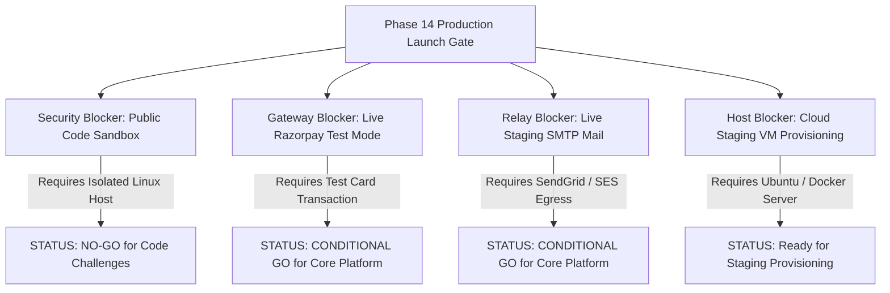

# SkillHub Platform — Phase 14: Remaining Release Blockers & Operational Tracking

**Document Reference:** SEC-BLOCKERS-PHASE14  
**Auditor Roles:** Principal Application Security Engineer & Release Manager  
**Date:** October 27, 2026  
**Status:** CODE REPOSITORIES HARDENED | 3 CLOUD INTEGRATION GATES REMAIN  

---

## 1. Summary of Remaining Production Blockers

---

## 2. Detailed Blocker Analysis & Remediation Requirements

### Blocker 1: External Isolated Code Runner Daemon Deployment
- **Risk Level:** **CRITICAL** (Arbitrary Code Execution, Sandbox Escape)
- **Affected Feature:** Public coding challenges, arbitrary Python/Java/C++/JS student execution.
- **Current Safeguard:** `skillhub.code-execution.runner-url` is empty by default; student code submissions fast-fail immediately with `EXECUTION_UNAVAILABLE`. No arbitrary code is ever executed on the Spring Boot application host JVM.
- **Required Remediation:**
  1. Provision a dedicated Linux server or isolated ECS/Kubernetes worker node separate from the main application VPC.
  2. Deploy the isolated runner container with unprivileged user permissions, dropped Linux capabilities (`--cap-drop=ALL`), disabled network egress (`--network none` during execution), read-only root filesystems, and strict CPU/memory cgroups (256MB RAM, 1 CPU core, 5-second CPU timeout).
  3. Verify the bearer token handshake between `SkillHub` and the runner.
- **Verdict Impact:** Public arbitrary code execution is strictly **NO-GO**.

---

### Blocker 2: Razorpay Test-Mode Gateway & Webhook Staging Handshake
- **Risk Level:** **HIGH** (Payment Flow Disruption, Checkout Failure)
- **Affected Feature:** Student paid course enrollments, instructor monthly subscription billing.
- **Current Safeguard:** Server-side HMAC-SHA256 signature verification and raw webhook payload validation are 100% verified in automated unit and integration tests.
- **Required Remediation:** Deploy application to staging with valid Razorpay test credentials (`rzp_test_*`), initiate a test transaction with test credit card `4111 1111 1111 1111`, and simulate a webhook delivery from the Razorpay dashboard.
- **Acceptance Criteria:** Order transitions to `PAID`, student enrollment activates, and audit log record is written to `payment_audit_logs`.

---

### Blocker 3: Staging Outbound SMTP Mail Relay Delivery
- **Risk Level:** **MEDIUM** (User Onboarding & Password Recovery Interruption)
- **Affected Feature:** Student/instructor registration verification, forgot-password token emails.
- **Current Safeguard:** Application handles email connection failures gracefully without throwing uncaught 500 errors to the client; warnings are logged with correlation IDs.
- **Required Remediation:** Inject valid transactional SMTP credentials (SendGrid, AWS SES, or Mailgun) into staging `.env`.
- **Acceptance Criteria:** Password reset email successfully arrives in a test inbox within 30 seconds of request.

---

### Blocker 4: Production MySQL Database Provisioning & Schema Baseline
- **Risk Level:** **HIGH** (Schema Validation Failure on Startup)
- **Affected Feature:** Application context startup under `prod` profile.
- **Current Safeguard:** `spring.jpa.hibernate.ddl-auto=validate` is configured.
- **Required Remediation:** Run `src/main/resources/db/migration/V1__skillhub_schema_baseline.sql` on the MySQL 8.0 staging database before launching the application container.
- **Acceptance Criteria:** Spring Boot starts up successfully and `/api/health/readiness` returns HTTP 200 with `database: UP`.

---

### Blocker 5: TLS 1.3 Certificate Installation & Reverse Proxy Binding
- **Risk Level:** **HIGH** (Data in Transit Protection, Cookie Security)
- **Affected Feature:** User authentication, session cookie encryption (`Secure` attribute).
- **Current Safeguard:** `nginx/skillhub.conf` contains production TLS 1.3 configuration, HSTS headers, and rate limiting.
- **Required Remediation:** Point staging domain DNS (A record) to the staging server IP and run `certbot --nginx -d staging.skillhub.com`.
- **Acceptance Criteria:** Qualys SSL Labs audit score of **A+**; HTTP traffic automatically redirects to HTTPS with HSTS.

---

### Blocker 6: Volume Mount & Clustered Storage / Sessions
- **Risk Level:** **MEDIUM** (Data Loss across Restarts, Multi-Node Inconsistency)
- **Affected Feature:** Instructor verification documents (Aadhaar), student exam certificates, session persistence.
- **Current Safeguard:** Single instance uses local volume `/var/skillhub/uploads` and in-memory servlet sessions.
- **Required Remediation:**
  1. For initial single-instance release: Ensure Docker volume `app-uploads` is bound to persistent cloud SSD storage.
  2. For future multi-instance horizontal scaling: Integrate AWS S3 / Google Cloud Storage for files and Redis for clustered HTTP sessions.
- **Acceptance Criteria:** Uploaded files persist across container restarts.

---

## 3. Operational Tracking Matrix

| Blocker ID | Severity | Environment | Verification Method | Status |
| :---: | :---: | :---: | :--- | :---: |
| BLK-01 | Critical | Staging / Prod | Runner pen-test & network isolation check | **NO-GO (Feature Disabled)** |
| BLK-02 | High | Staging | Razorpay test mode card checkout & webhook | **PENDING STAGING** |
| BLK-03 | Medium | Staging | Password reset email arrival in test inbox | **PENDING STAGING** |
| BLK-04 | High | Staging | MySQL 8.0 baseline DDL execution | **PENDING STAGING** |
| BLK-05 | High | Staging | Let's Encrypt TLS certificate binding | **PENDING STAGING** |
| BLK-06 | Medium | Staging | Container restart persistence check | **PENDING STAGING** |
