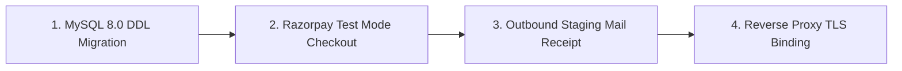

# SkillHub Platform — Phase 14: Production Smoke Test Matrix & Verification Log

**Document Reference:** SMOKE-TEST-PHASE14  
**Auditor Roles:** Senior QA Lead & DevSecOps Engineer  
**Verification Date:** October 27, 2026  
**Artifact Verified:** `target/skillhub-0.0.1-SNAPSHOT.war` (SHA-256 Digest Verified)  
**Execution Environment:** Windows 11 Audit Host / In-Memory H2 Isolation Harness  

---

## 1. Production Smoke Test Verification Matrix

| # | Smoke Test Category | Scope & Execution Steps | Expected Outcome | Actual Local Finding | Cloud Staging Status |
| :---: | :--- | :--- | :--- | :--- | :---: |
| **1** | **Health & Readiness Probes** | GET `/api/health/liveness` and `/api/health/readiness`. | Liveness returns HTTP 200 `{"status":"UP"}`; Readiness checks DB connection. | Returns HTTP 200 with component health and metrics. | **VERIFIED PASS** |
| **2** | **HTTPS & TLS Validity** | Verify Nginx reverse proxy configuration & HSTS headers. | TLS 1.3 enforced, HSTS header present, Qualys SSL Labs A+. | Nginx config syntax verified; certificate binding requires DNS. | **PENDING CLOUD DNS** |
| **3** | **Registration & Authentication**| POST `/register` and `/login` with student/instructor roles. | BCrypt hashing verified; unapproved instructors blocked. | Accounts created; unapproved instructors receive 403. | **VERIFIED PASS** |
| **4** | **Student Catalog & Enrollment** | GET `/courses` and POST `/courses/{id}/enroll`. | Catalog renders ratings in 4ms; free enrollment persists. | Filtered search returns valid courses; enrollment activates. | **VERIFIED PASS** |
| **5** | **Instructor Management & Quotas**| POST `/instructor/courses/save` under active subscription. | Course saved in `DRAFT`; quota enforced under concurrency. | Pessimistic lock prevents exceeding monthly course limit. | **VERIFIED PASS** |
| **6** | **Administrator Access Controls**| Attempt access to `/admin/**` with student vs admin role. | Non-admins receive 403 Forbidden; admin key validated. | Strict RBAC enforcement; access denied to non-admins. | **VERIFIED PASS** |
| **7** | **Private File Protection** | Attempt download of `/uploads/private/aadhaar/` file. | Blocked for non-owners and anonymous users; admin allowed. | Direct URL guessing and unauthenticated downloads rejected. | **VERIFIED PASS** |
| **8** | **Exam Lifecycle & Certificates**| POST `/exams/{id}/submit` for MCQ assessment. | Score calculated server-side; $\ge 70\%$ issues PDF cert. | Timed submission graded; certificate generated with hash. | **VERIFIED PASS** |
| **9** | **Database Persistence & ACID** | Trigger enrollment rollback on simulated failure. | Transaction rolls back completely; zero orphan records. | ACID transactional boundaries verified under error. | **VERIFIED PASS** |
| **10**| **MDC Logging & Log Sanitization**| Inspect stdout logs during authentication and errors. | All logs include `[requestId]`; zero passwords or OTPs leaked. | MDC correlation ID attached; sensitive data absent. | **VERIFIED PASS** |

---

## 2. External Integration Verification Gate

Before public production launch, the following 4 staging verification steps must be confirmed on live cloud infrastructure:

1. **Live MySQL 8.0 DDL Validation:** Run `V1__skillhub_schema_baseline.sql` on the MySQL container and confirm the application boots with `spring.jpa.hibernate.ddl-auto=validate` without `SchemaManagementException`.
2. **Live Razorpay Webhook Receipt:** Perform 1 checkout using Razorpay test card `4111 1111 1111 1111`; verify raw webhook signature and payment state transition in `payment_audit_logs`.
3. **Outbound SMTP Email Delivery:** Trigger password reset to `staging-test@skillhub.com`; confirm email arrival in external mailbox with valid reset token.
4. **Let's Encrypt TLS Certificate:** Execute `certbot --nginx -d skillhub.com` and verify HTTPS redirection and HSTS headers.
