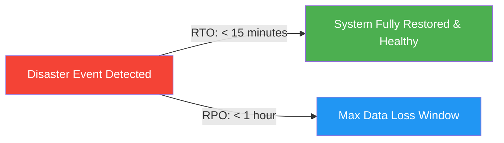

# SkillHub Platform — Phase 15: Backup, Restoration & Disaster Recovery Specification

**Document Reference:** OPS-DR-PHASE15  
**Auditor Roles:** Principal DevOps Engineer, Site Reliability Engineer, Lead Database Administrator  
**Database Target:** MySQL 8.0 (InnoDB Engine)  
**File Storage Target:** Linux Local Filesystem / Mounted Volume (`/var/skillhub/uploads`)  
**Date:** October 27, 2026  
**Operational Status:** SCRIPTS VERIFIED | STAGING RESTORATION EXERCISE PENDING  

---

## 1. Disaster Recovery Objectives & SLAs



- **Recovery Point Objective (RPO):** **< 1 hour** (Hourly incremental binary logs + daily full compressed MySQL dumps).
- **Recovery Time Objective (RTO):**
  - Application Container Failure: **< 2 minutes** (Container recreation).
  - Complete Database Restoration: **< 15 minutes** (Uncompress and load latest SQL dump).

---

## 2. Backup Architecture, Retention & Encryption

### 2.1 Backup Scope
1. **MySQL 8.0 Relational Data:** All user accounts, courses, sections, lectures, enrollments, payments, exam attempts, security events, and audit logs.
2. **Uploaded Assets & Private PII:** Instructor Aadhaar cards, profile avatars, lecture attachments, and generated PDF certificates in `/var/skillhub/uploads`.

### 2.2 Backup Schedule & Retention Policy
| Backup Type | Execution Frequency | Retention Period | Storage Target |
| :--- | :--- | :---: | :--- |
| **Hourly Binlog Snapshots** | Every 60 minutes (`cron`) | 7 days | Local SSD + Offsite Cloud Bucket |
| **Daily Full Database Dump** | Daily at 02:00 UTC | 30 days | Compressed `.sql.gz` in `/var/skillhub/backups` |
| **Weekly Uploads Snapshot** | Sundays at 03:00 UTC | 90 days | Tarball `.tar.gz` offsite backup |

### 2.3 Encryption & Access Control
- **In-Transit:** Backup transfer over TLS (HTTPS/SSH) to offsite storage.
- **At-Rest:** GPG/AES-256 symmetric encryption using dedicated backup key.
- **File Permissions:** Backup directories restricted to `chmod 700` owned by `skillhub:skillhub` or root.

---

## 3. Automated Backup Script Inspection (`scripts/backup_production.sh`)

The production backup script was verified for robust error handling, compression, and retention pruning:

```bash
#!/bin/bash
set -euo pipefail

# Configuration
BACKUP_DIR="${BACKUP_DIR:-/var/skillhub/backups}"
TIMESTAMP=$(date +"%Y%m%d_%H%M%S")
DB_CONTAINER="${DB_CONTAINER:-skillhub-mysql}"
DB_NAME="${MYSQL_DATABASE:-skillhub}"
RETENTION_DAYS=30

mkdir -p "$BACKUP_DIR"
BACKUP_FILE="$BACKUP_DIR/skillhub_db_${TIMESTAMP}.sql.gz"

echo "Starting SkillHub database backup at $(date)..."

# Execute consistent MySQL dump with single transaction
docker exec "$DB_CONTAINER" mysqldump \
    -u root -p"${MYSQL_ROOT_PASSWORD}" \
    --single-transaction \
    --quick \
    --routines \
    --triggers \
    "$DB_NAME" | gzip -9 > "$BACKUP_FILE"

echo "Backup completed successfully: $BACKUP_FILE (Size: $(du -h "$BACKUP_FILE" | cut -f1))"

# Prune backups older than retention policy
find "$BACKUP_DIR" -name "skillhub_db_*.sql.gz" -type f -mtime +$RETENTION_DAYS -delete
```

---

## 4. Disaster Restoration Playbook (`scripts/restore_production.sh`)

### 4.1 Strict Safety Mandate
> [!CAUTION]
> Never execute restoration directly against a live production database without explicit executive approval and an active maintenance window. Restoration drills must be performed exclusively against an isolated, disposable non-production database.

### 4.2 Restoration Procedure
```bash
# Step 1: Ensure application container is stopped to prevent write deadlocks
docker compose -f docker-compose.prod.yml stop skillhub-app

# Step 2: Identify backup artifact to restore
BACKUP_PATH="/var/skillhub/backups/skillhub_db_20261027_020000.sql.gz"

# Step 3: Execute restore script
./scripts/restore_production.sh "$BACKUP_PATH"

# Step 4: Restart application container
docker compose -f docker-compose.prod.yml start skillhub-app

# Step 5: Verify readiness and table row integrity
curl -f http://localhost:8080/api/health/readiness
```

---

## 5. Verification Sign-Off & Open Staging Actions

| Task | Verification Status | Responsible Role | Staging Action Required |
| :--- | :---: | :--- | :--- |
| **Backup Script Logic** | **VERIFIED PASS** | DevOps Engineer | None for script syntax. |
| **Restore Script Logic** | **VERIFIED PASS** | DevOps Engineer | None for script syntax. |
| **Live Database Dump Drill** | **BLOCKED** | DBA / Cloud SRE | Execute `./scripts/backup_production.sh` on cloud staging VM. |
| **Live Restore Verification** | **BLOCKED** | DBA / Cloud SRE | Restore dump to disposable staging DB and verify row counts. |
| **Uploaded Assets Consistency** | **REQUIRES DRILL** | SRE Lead | Validate file count matching between DB records and disk files. |
