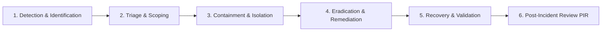

# SkillHub Platform — Phase 15: Security & Operational Incident Response Runbook

**Document Reference:** OPS-IR-PHASE15  
**Auditor Roles:** Principal Application Security Engineer, SRE Lead, Security Operations Center (SOC) Lead  
**Classification:** Internal Operational Playbook  
**Date:** October 27, 2026  

---

## 1. Incident Management Lifecycle

SkillHub adheres to the NIST SP 800-61 Rev. 2 Computer Security Incident Handling Guide:



---

## 2. Severity Classification Matrix

| Severity Level | Impact Description | Examples | Target Response Time | Escalate To |
| :---: | :--- | :--- | :---: | :--- |
| **P1 - CRITICAL** | Platform-wide outage, active data exfiltration, database corruption, payment bypass. | Complete downtime, unauthorized admin account creation, mass PII compromise. | **< 15 minutes** | Incident Commander, Lead Architect, CTO |
| **P2 - HIGH** | Major feature unavailable, elevated error rates, suspicious brute force attack. | Checkout failures, HikariCP pool exhaustion, single component crash. | **< 30 minutes** | SRE Lead, Backend Lead |
| **P3 - MEDIUM** | Non-critical bug, degraded performance, isolated email delivery issues. | Course creation slow, password reset delays, background notification retry. | **< 2 hours** | On-Call Engineer |
| **P4 - LOW** | Minor cosmetic glitch, single non-blocking error. | Typo in email template, minor CSS misalignment on mobile. | **< 24 hours** | QA Lead |

---

## 3. Specific Threat Scenarios & Playbooks

### 3.1 Playbook A: Credential Stuffing / Brute Force Authentication Attack
1. **Detection:** Alert `SuspiciousAuthFailureSpike` fires (> 10 auth failures/minute).
2. **Investigation:**
   - Search logs via Loki/Grafana: `grep "Authentication failed" /var/log/skillhub/app.log | awk '{print $NF}' | sort | uniq -c`.
   - Identify attacker IP addresses or targeting specific accounts.
3. **Containment:**
   - Add malicious CIDR block to Nginx IP blacklist in `/etc/nginx/conf.d/blocklist.conf`:
     ```nginx
     deny 198.51.100.42;
     ```
   - Reload Nginx: `sudo nginx -s reload`.
4. **Validation:** Verify error rates return to normal baseline.

### 3.2 Playbook B: Payment Verification Anomaly / Signature Mismatch
1. **Detection:** Alert `RazorpayVerificationFailures` fires.
2. **Investigation:**
   - Grep logs for `requestId` corresponding to the payment callback.
   - Inspect `payment_audit_logs` table for transition errors or amount tampering (`PAYMENT_AMOUNT_MISMATCH`).
3. **Containment:**
   - If an ongoing exploit attempt is detected, temporarily disable checkout routes via Nginx:
     ```nginx
     location /api/payments/create-order { return 503; }
     ```
   - Rotate `RAZORPAY_WEBHOOK_SECRET` in `.env` if webhook forging is suspected.
4. **Remediation:** Verify order amount logic and re-enable checkout.

### 3.3 Playbook C: Database Connection Pool Exhaustion (HikariCP Starvation)
1. **Detection:** `/api/health/readiness` returns HTTP 503; logs report `Connection is not available, request timed out after 20000ms`.
2. **Investigation:**
   - Inspect active queries in MySQL:
     ```sql
     SHOW FULL PROCESSLIST;
     SELECT * FROM performance_schema.data_locks;
     ```
   - Identify unindexed long-running queries or table lock contentions.
3. **Containment:**
   - Terminate offending query: `KILL <process_id>;`.
   - If deadlocked, gracefully restart application container: `docker compose restart skillhub-app`.
4. **Remediation:** Ensure batch rating or pessimistic lock timeouts are tuned.

---

## 4. Evidence Preservation & Forensic Protocol

1. **Do Not Terminate Containers Prematurely:** If a container compromise is suspected, pause the container rather than killing it to preserve memory state:
   ```bash
   docker pause skillhub-app
   ```
2. **Export Volatile Memory & Logs:**
   ```bash
   docker logs skillhub-app > /var/skillhub/forensics/app_crash_$(date +%s).log
   ```
3. **Inspect Audit Tables:** Query `admin_logs` and `professional_exam_security_events` for unauthorized privilege escalation or tampering.

---

## 5. Post-Incident Review (PIR) Requirements

Within 48 hours of resolving any P1 or P2 incident, the Incident Commander must produce a formal PIR detailing:
1. Executive timeline of events (Detection, Response, Recovery).
2. Root cause analysis (5 Whys methodology).
3. Preventive corrective actions with assigned engineering owners.
4. Updates to regression tests or automated alert rules.
