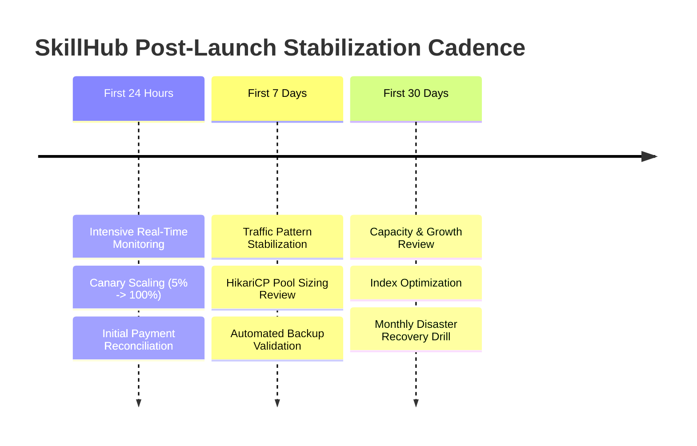

# SkillHub Platform — Phase 15: Production Stabilization Playbook & Operational Checklist

**Document Reference:** OPS-STABILIZE-PHASE15  
**Auditor Roles:** Principal Site Reliability Engineer, QA Lead, Production Support Engineer  
**Date:** October 27, 2026  
**Operational Status:** OPERATIONAL PROTOCOL PREPARED (PENDING LIVE DEPLOYMENT)  

---

## 1. Overview & Phased Stabilization Timeline

> [!NOTE]
> This stabilization protocol governs operational oversight immediately following an authorized live production cutover. No live traffic has yet occurred; this document serves as the mandatory operational guide for the on-call engineering team upon release.

---

## 2. Phase 1: First 24 Hours (Intensive Real-Time Watch)

### Cadence: Hourly Checks & Continuous On-Call Paging
- [ ] **Health Probe Stability:** Confirm `/api/health/liveness` and `/api/health/readiness` remain HTTP 200 continuously with zero 503 flapping.
- [ ] **HTTP 5xx Error Budget:** Verify HTTP 5xx error rate remains below **0.1%** across all endpoints.
- [ ] **HikariCP Connection Pool Utilization:** Ensure active connections remain below **12** (60% of pool capacity) during peak enrollment hours.
- [ ] **Initial Payment Reconciliation:** Match Razorpay Merchant Dashboard settled payments against `payment_audit_logs` records; verify zero signature mismatches.
- [ ] **Outbound Mail Delivery Verification:** Confirm registration confirmation and password reset emails are delivered within 60 seconds of trigger.
- [ ] **Security Anomaly Scan:** Review `admin_logs` and MDC logs for suspicious IP spikes, unhandled 403s, or CSRF token rejection surges.
- [ ] **Disk Usage Baseline:** Check `/var/skillhub/uploads` storage growth rate; verify video uploads are properly bounded by 100MB limit.
- [ ] **Rollback Trigger Verification:** Confirm rollback triggers are active; if error rate exceeds 1.0% or DB locks deadlock, trigger emergency container rollback.

---

## 3. Phase 2: First 7 Days (Early Operational Stabilization)

### Cadence: Daily Reviews at 09:00 UTC
- [ ] **Traffic Scaling Review:** Analyze daily active user (DAU) peaks; evaluate Nginx request rate limiters (`10r/s` per IP) to ensure legitimate students are not rate-limited.
- [ ] **Slow Query Log Inspection:** Enable MySQL slow query log (`long_query_time = 1.0`); review any queries exceeding 1,000ms and verify index usage.
- [ ] **Static Asset Cache Hit Ratio:** Check Nginx cache logs and browser 304 response ratios; verify static assets (`/css/*`, `/js/*`, images) achieve $\ge 85\%$ cache hit rate.
- [ ] **First Automated Backup Audit:** Inspect the daily 02:00 UTC database backup in `/var/skillhub/backups/`; verify file size consistency and gzip integrity via `gzip -t`.
- [ ] **Instructor Quota Enforcement Review:** Verify instructors have not bypassed monthly subscription course quotas under concurrent creation workflows.
- [ ] **User-Reported Defect Triage:** Daily sync between Customer Support and QA Lead to review tickets; classify bugs and schedule patch releases.
- [ ] **Log Retention & Rotation:** Confirm Docker log rotation (`max-size: 50m`, `max-file: 5`) prevents disk exhaustion.

---

## 4. Phase 3: First 30 Days (Operational Maturity & Growth Planning)

### Cadence: Weekly Reviews & Month-End Sign-Off
- [ ] **Monthly Financial & Subscription Reconciliation:** Complete full audit of course revenues, instructor platform subscription fees, and refunds against banking records.
- [ ] **Non-Production Disaster Recovery Exercise:** Execute `./scripts/restore_production.sh` against an isolated disposable staging database; verify row count parity and recovery time (< 15 minutes).
- [ ] **TLS Certificate Renewal Validation:** Confirm Let's Encrypt automated renewal cron has checked certificate validity (renewal triggered at 30 days remaining).
- [ ] **Database Growth & Partitioning Evaluation:** Measure monthly row growth in high-frequency tables (`notifications`, `payment_audit_logs`, `exam_attempts`); plan time-based table partitioning if row counts exceed 1,000,000.
- [ ] **Code Runner Readiness Evaluation:** Assess status of the isolated Linux container runner daemon (`external-runner:8088`); determine whether public untrusted coding challenges can graduate from **NO-GO** to canary staging.
- [ ] **Horizontal Scaling Architecture Review:** If concurrent users approach 100 VUs, begin implementation of Redis session clustering and AWS S3 object storage migration.

---

## 5. Rollback & Emergency Cutoff Criteria

The on-call Incident Commander has unilateral authority to initiate an emergency rollback if any of the following triggers are breached:

| Metric | Threshold | Action |
| :--- | :--- | :--- |
| **HTTP 5xx Errors** | > 1.0% over 2 minutes | Revert container to previous release tag. |
| **HikariCP Pool** | 100% active for > 3 minutes | Restart app container; kill blocking queries. |
| **Payment Failures** | > 2 consecutive webhook errors | Temporarily disable checkout endpoints. |
| **Security Breach** | Confirmed data exfiltration / unauthorized admin | Pause app container; isolate network; notify executive team. |
