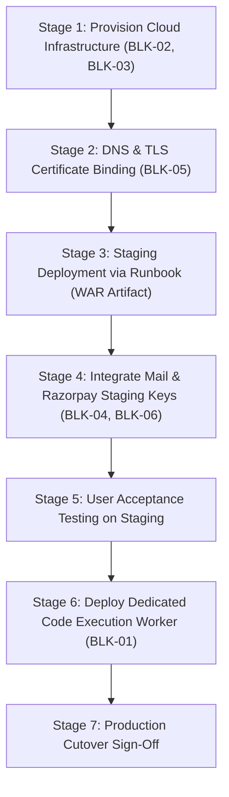

# SKILLHUB PRODUCTION HARDENING — PHASE 16
## OPEN PRODUCTION BLOCKERS & INFRASTRUCTURE DEPENDENCY REGISTER

**Document ID:** SKILLHUB-PHASE16-OBR-004  
**Date:** October 27, 2026  
**Status:** ACTIVE AUDIT REGISTER  
**Release Readiness:** CONDITIONAL GO FOR STAGING / NO-GO FOR UNRESTRICTED PUBLIC PRODUCTION  

---

## 1. Executive Overview

While the SkillHub application codebase, Spring Security configuration, and automated test suite (200 tests passing) are verified and staging-ready, unrestricted public production cutover remains **BLOCKED** by 7 external infrastructure and operational dependencies.

The table below outlines each blocker, its security impact, current status, owner, and resolution criteria.

---

## 2. Granular Blocker Register

| Blocker ID | Domain / Component | Status | Owner | Security / Operational Impact | Verification & Resolution Criteria |
| :--- | :--- | :---: | :--- | :--- | :--- |
| **BLK-01** | **Public Arbitrary Code Execution Runner** | **NO-GO** | Security Team / DevOps | Executing untrusted student Python/Java/C++ code on the main application server introduces severe host compromise and remote code execution (RCE) risks. | Deploy a dedicated, network-isolated Linux worker host with gVisor (`runsc`), nsjail, or Firecracker microVMs. Configure `SKILLHUB_CODE_EXECUTION_RUNNER_URL` and HMAC shared secret. Verify timeout, memory, and egress isolation before enabling. |
| **BLK-02** | **Staging Cloud VM Provisioning** | **BLOCKED** | DevOps / SRE | Application is currently packaged locally on Windows 11 without a running Docker daemon or cloud staging VM. | Provision an Ubuntu 22.04 LTS / 24.04 LTS cloud VM (minimum 4 vCPU, 8 GB RAM, 50 GB NVMe). Install Docker Engine 24+ and Docker Compose 2+. Verify SSH access and firewall ingress. |
| **BLK-03** | **Production MySQL 8.0 Provisioning** | **BLOCKED** | Database Admin | Production database server is not yet provisioned; local environment uses in-memory H2 for testing. | Provision managed MySQL 8.0 instance (e.g. AWS RDS or DigitalOcean Managed DB) with utf8mb4 collation. Run `V1__skillhub_schema_baseline.sql`. Verify all 42 tables and indices match baseline. |
| **BLK-04** | **Production Razorpay Live Credentials** | **BLOCKED** | Finance / DevOps | Local tests run against mock Razorpay keys (`rzp_test_mock`). Live payments cannot process. | Obtain live Razorpay Key ID and Secret from merchant dashboard. Configure webhook endpoint `https://skillhub.com/api/payment/webhook` with HMAC SHA-256 secret. Execute 1 successful end-to-end sandbox payment transaction. |
| **BLK-05** | **Production TLS & DNS Binding** | **BLOCKED** | SRE / Network Admin | Production domains (`skillhub.com`, `staging.skillhub.com`) do not resolve to a live host; TLS certificates are not bound. | Point DNS A-records to staging/production server IP. Issue Let's Encrypt TLS 1.3 certificates via Certbot. Verify SSL Labs grade A+ and HTTPS enforcement. |
| **BLK-06** | **Production SMTP Relay Configuration** | **BLOCKED** | DevOps / IT Admin | Outbound port 587 is blocked on the local development workstation. Password reset and verification emails cannot deliver. | Configure production mail relay (SendGrid, AWS SES, or Postmark) in `/opt/skillhub/.env`. Verify delivery of OTP reset emails to external inboxes. |
| **BLK-07** | **Cloud S3 / Blob Storage for Uploads** | **BLOCKED** | DevOps / Cloud Architect | File uploads (videos, instructor identity proof documents, resume PDFs) are stored in local `/uploads` directory, risking data loss on container recreation. | Configure AWS S3 or MinIO compatible object storage with private bucket policies for identity documents and public/CDN read access for course videos. |

---

## 3. Mandatory Security Guard: Code Execution Policy

> [!CAUTION]
> Under no circumstances should `MockCodeExecutionProvider` or local subprocess execution be enabled in a production profile.
> 
> The codebase enforces this through a hard fail-fast check in [MockCodeExecutionProvider.java](file:///c:/Users/kisho/OneDrive/Desktop/New%20folder/Skill/src/main/java/com/skillhub/provider/impl/MockCodeExecutionProvider.java):
> ```java
> if ((executionMode == null || "mock".equalsIgnoreCase(executionMode)) && 
>     ("production".equalsIgnoreCase(activeProfile) || "prod".equalsIgnoreCase(activeProfile))) {
>     throw new IllegalStateException("CRITICAL SECURITY VIOLATION: MockCodeExecutionProvider cannot be activated in production profile!");
> }
> ```
> Until **BLK-01** is fully resolved and certified by the Application Security Engineer, the property `skillhub.code-execution.runner-url` MUST remain empty. All code evaluation requests will safely fail fast with `EXECUTION_UNAVAILABLE`.

---

## 4. Resolution Roadmap & Action Plan



### Immediate Next Steps:
1. **Week 1:** Infrastructure team provisions staging VM and managed MySQL 8.0 instance.
2. **Week 1:** DevOps team runs `V1__skillhub_schema_baseline.sql` and deploys `skillhub-0.0.1-SNAPSHOT.war`.
3. **Week 2:** Quality Assurance verifies live Razorpay test transactions and real SMTP email delivery.
4. **Week 2:** Application Security certifies external isolated code execution runner.
5. **Week 3:** Final Production Cutover Gate review.
